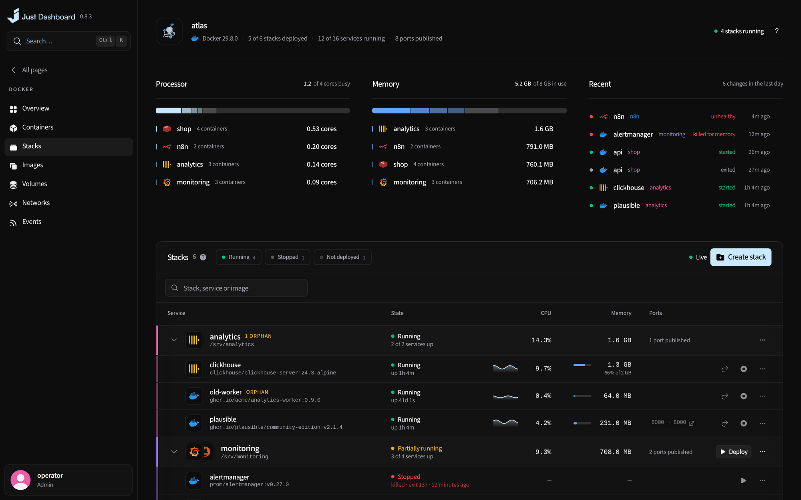
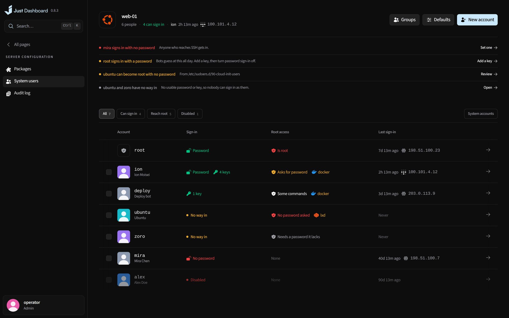

<picture><source media="(prefers-color-scheme: dark)" srcset="frontend/public/brand-logo/just-dashboard-horizontal-blue.svg"></picture>

# Features

**Everything one Linux server needs, in one private control panel.** Free, with nothing held back for a paid tier.

[README](README.md) · **Features** · [Install](docs/guides/install.md) · [Security](SECURITY.md) · [Changelog](CHANGELOG.md)

<table>
<tr>
<td width="25%" valign="top"><b>Readings and controls</b> See what the server is doing through live readings, recorded events and logs. Open the owning controls to review and apply a change.</td>
<td width="25%" valign="top"><b>Private by design</b> Root-equivalent power belongs behind Tailscale or an SSH tunnel. The allowlist runs before the login, and every change is audited.</td>
<td width="25%" valign="top"><b>One server, done properly</b> No fleet, no cloud account, no AI model or API key required. One <code>docker compose</code> stack that knows its machine.</td>
<td width="25%" valign="top"><b>Free, every feature</b> Self-hosted and AGPL-3.0. Every feature is free and stays free.</td>
</tr>
</table>

<table>
<tr>
<td width="50%" valign="top">

<h3><a href="docs/features/monitoring.md">Overview & monitoring</a></h3>
Live readings, a map of the whole server, seven days of history, alerts and capacity forecasts.
</td>
<td width="50%" valign="top">

<h3><a href="docs/features/deployments.md">Deployments</a></h3>
Repositories, images, Compose or 157 templates, with previews, canaries and one-click rollback.
</td>
</tr>
<tr>
<td width="50%" valign="top">

<h3><a href="docs/features/docker.md">Docker</a></h3>
Containers, stacks, images, volumes and networks, with what each uses and what just happened.
</td>
<td width="50%" valign="top">

<h3><a href="docs/features/databases.md">Databases</a></h3>
Nine engines, a SQL editor and assistant, point-in-time recovery and an MCP server for AI clients.
</td>
</tr>
<tr>
<td width="50%" valign="top">

<h3><a href="docs/features/workspace.md">Workspace</a></h3>
A terminal that survives restarts, files, full Git, live drawings and your own computers in a tab.
</td>
<td width="50%" valign="top">

<h3><a href="docs/features/network.md">Network</a></h3>
Live topology, firewall, WireGuard and Tailscale, DNS, traffic per program and 26 diagnostics.
</td>
</tr>
<tr>
<td width="50%" valign="top">

<h3><a href="docs/features/proxy-tls.md">Proxy & TLS</a></h3>
Every domain drawn through nginx or Caddy to its app, with certificates and a live TLS report.
</td>
<td width="50%" valign="top">

<h3><a href="docs/features/security-backups.md">Security & backups</a></h3>
A verdict on the host, fail2ban and CrowdSec, encrypted backups and a map of what is not covered.
</td>
</tr>
<tr>
<td width="50%" valign="top">

<h3><a href="docs/features/server-accounts.md">Server & accounts</a></h3>
Package updates, system users, roles, passkeys, API keys, an audit log and one-click self-update.
</td>
<td width="50%" valign="top">

<h3><a href="docs/features/everywhere.md">Everywhere</a></h3>
Ctrl/⌘K search with previews, keyboard shortcuts on every page, and a design built around readings.
</td>
</tr>
</table>

Screenshots show example data at 0.8.3. What changed in each release is in the <a href="CHANGELOG.md">changelog</a>.

