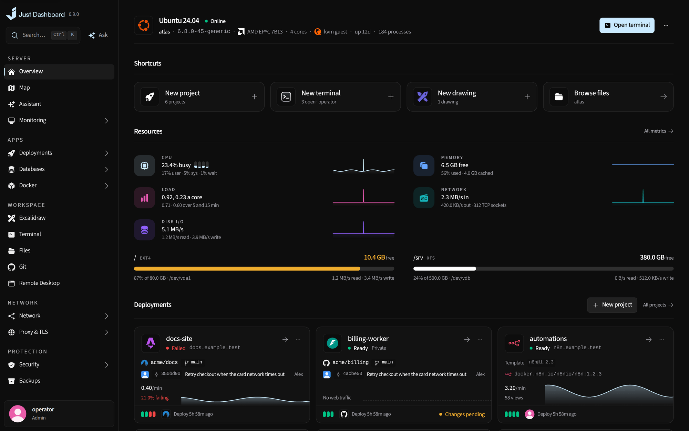

<div align="center">

<picture><source media="(prefers-color-scheme: dark)" srcset="frontend/public/brand-logo/just-dashboard-horizontal-blue.svg"></picture>

### Your whole Linux server, in one private control panel.

Deploy apps, run Docker, manage databases, shape the network, open a real shell and keep it all
backed up, behind one login that lives on your private network.

**Version 0.9.0** · Free and self-hosted · AGPL-3.0

[](#install)
[](FEATURES.md)
[](#documentation)
[](SECURITY.md)
[](CHANGELOG.md)
[](https://just-dashboard.com)

</div>

<a href="FEATURES.md"></a>

## What it does

Just Dashboard is one control panel for one Linux server. It deploys your apps, runs your containers and
databases, manages the network, proxy and certificates, and gives you a real terminal, files and Git in the
browser. It needs no fleet, no cloud account and no paid tier: **every feature is free and stays free.**
[See every feature →](FEATURES.md)

## Install

You need a Linux server you have root on:

- **x86_64 or arm64**, running **systemd**: one of the [supported distributions](#supported-distributions).
- **2 GB of memory with 2 GB of swap, or 3 GB of memory.** Running the dashboard takes far less; building
  it during setup and every update is what needs the room.
- **10 GB of free disk** for the images.
- Docker, which the installer installs when it is missing.

The installer checks all of this before it changes anything.

```bash
git clone --depth 1 --single-branch --branch main https://github.com/JustDashboard/Just-Dashboard.git
cd Just-Dashboard && sudo ./install.sh
```

The installer asks how you will reach the dashboard, then does the rest and prints how to get in:

- **Tailscale (default):** the machine stays invisible to the internet, and the dashboard answers at
  `https://your-box.tailnet-name.ts.net:8443` with a real certificate.
- **SSH tunnel:** the dashboard is served on loopback only.

Upgrade with **Update now** in the dashboard. [Everything about installing →](docs/guides/install.md)

## Supported distributions

Each release below was installed from scratch and then used, on 28 November 2026, at commit
`286fb9504`. On a fresh machine of each one, `sudo ./install.sh` ran with the answers a person gives.
Then the run signed in, opened the data behind every page (each of the 331 read-only API routes), ran
a command in the web terminal, restarted the machine and did all of it again. Nothing was fixed by hand
along the way. [`scripts/verify-distros/run.sh`](scripts/verify-distros/run.sh) is the run, and
anyone can repeat it.

| Distribution | Releases |
| --- | --- |
| **Ubuntu** | 22.04 LTS, 24.04 LTS, 26.04 LTS |
| **Debian** | 12, 13 |
| **Linux Mint** | 22.3 |
| **Kali Linux** | Rolling |
| **Parrot Security** | 7 |
| **deepin** | 25 |
| **Fedora** | 44, 45 |
| **CentOS Stream** | 9, 10 |
| **Rocky Linux** | 9, 10 |
| **AlmaLinux** | 9, 10 |
| **Oracle Linux** | 9, 10 |
| **Amazon Linux** | 2023 |
| **openSUSE** | Leap 16.0, Tumbleweed |
| **Arch Linux** | Rolling |
| **Manjaro** | Rolling |

- **Desktop or server makes no difference.** A desktop edition is the same release with a desktop on
  top, so Ubuntu's flavours, Fedora Workstation and the like are covered by their row.
- **One thing is missing on the newest releases.** Debian 13, Ubuntu 26.04, Kali, Parrot, deepin and
  openSUSE no longer keep the record of failed sign-ins that Security → Logins reads, so that list stays
  empty there. Login history and everything else work.
- **Without systemd, setup refuses.** On Alpine, Devuan, Void and the like, the installer stops before it
  changes anything (checked on Alpine and Devuan).
- **Not checked yet:** arm64, which the installer accepts but the run had no machine for; Red Hat
  Enterprise Linux itself, which needs a subscription (Rocky, AlmaLinux and Oracle Linux are rebuilds of
  it); Pop!_OS, Zorin OS and elementary OS, which have no image to test from and install the way Linux
  Mint does; Raspberry Pi OS, NixOS and Gentoo.
- **How the machines were made:** each was the release's official image booting its own systemd, with its
  own Docker inside. They ran on one x86_64 host with Linux 6.8, so the run covers each distribution's
  packages, init and tools, not its kernel. Docker Hub was reached through a local cache of the same
  images, and Tumbleweed's packages through openSUSE's own CDN, after one of the mirrors its redirector
  picks at random stalled two runs.

## Documentation

| Guide | What it covers |
| --- | --- |
| [**Features**](FEATURES.md) | Every area of the dashboard, with screenshots |
| [**Install and upgrade**](docs/guides/install.md) | What the installer does, first sign-in and upgrading |
| [**Configuration**](docs/guides/configuration.md) | Every environment variable, and running it by hand |
| [**The `jd` command line**](docs/guides/cli.md) | Deploy from a terminal, CI or an AI client |
| [**Administration**](docs/guides/administration.md) | Account scripts, API keys, updates, backups and uninstalling |
| [**Linking and the usage count**](docs/guides/linking-and-usage.md) | The two optional things that talk to just-dashboard.com, and connecting to a Just Hub on your tailnet |
| [**Connecting GitHub**](docs/guides/github.md) | The GitHub page: setting up its App, signing in from any address, cloning onto the server |
| [**Security**](SECURITY.md) | How the dashboard protects your server, and how to report a vulnerability |
| [**Contributing**](CONTRIBUTING.md) | How to work on the project |

## Who builds this

Just Dashboard is built by one person, [Wayy01](https://github.com/Wayy01), under the
[JustDashboard](https://github.com/JustDashboard) organisation.

If it has saved you an evening, you can buy me a coffee. It is entirely optional.

[](https://buymeacoffee.com/ionmoisei72)

## Sponsors and investors

*None yet, so this space is open.* To sponsor or invest in the project, write to
[ionmoisei755@gmail.com](mailto:ionmoisei755@gmail.com). Sponsors are listed here with a logo and a link.

## Licence

[AGPL-3.0](LICENSE). Run it, change it and distribute it, but if you run a modified version as a network service,
publish your changes. The product logos bundled in `frontend/public/logos/` are their owners' trademarks and keep
their own licences, listed in that directory's `NOTICE`.
