# Log filters, Insights and per-page log sources

What changed on 2026-10-11, at the operator's request, everywhere a log is read: `/logs`, every
service page's `ServiceLogs` pane, and the deployment and site request workspaces. The rules are in
[`frontend/design-system.md`](../../internal/frontend/design-system.md) (search "The log panes' filters
took one shape"), the log UI in [`backend/docker-files-logs.md`](../../internal/backend/docker-files-logs.md)
and the visitor count in [`deployments/request-observability.md`](../../internal/deployments/request-observability.md).

The screenshots are recorded by `capture.ts` against a production build, with the API mocked from the
browser fixtures (a Postgres log; the showcase deployment with a request window carrying an audience):

```bash
JD_BROWSER_BASE_URL=http://127.0.0.1:<port> bun docs/audits/2026-10-11-log-filters-insights/capture.ts before|after
```

## What the reader complained about, and what answers it

| Before | After |
| --- | --- |
| The filter bar was four kinds of control: a brand Search alone, a filled select, a ghost More, bare chips, and `/` and `B` glyphs at the end of the field | One face: the field holds `.*`, `Aa` and Search inside its edge; the window, Options and the request bar's Took, Live and Export are outline controls at its height |
| "Custom range" in a select, its two date fields a row lower; nothing said Live was not reading a window | One time window: *Live* with its dot, a preset or the span on the trigger; presets and a typed span in one popover; a preset picked on the stream opens History |
| The level chips sat a row below the quick views, the chart between them | One filter row: Options' settings as chips, the levels with coloured counts, Fields, the quick views, and Clear filters |
| A grey histogram; a still pane | Info in the chart blue, a taller chart that reads a column out by series and takes a drag; the stream's last minute as a moving pulse beside *Live* |
| Wrap, Time, Colour and Copy as loose buttons, some with a ground and some without | The view switches as one segmented group; Pause, Copy and Clear as glyphs |
| Insights opened on charts with "one column is 30s" and "Slowest tenth" | A log's Insights opens on its lines, errors, warnings, busiest minute and p95; a request record's on its visitors, page views, bots, where they came from and on what |
| The request Insights listed IP addresses, never people | Visitors: distinct people (an address and a browser that opened a page), their devices, browsers and systems, and the most active as the browser on its system with their trail of pages |

## Screenshots

| | Before | After |
| --- | --- | --- |
| `/logs`, Live | 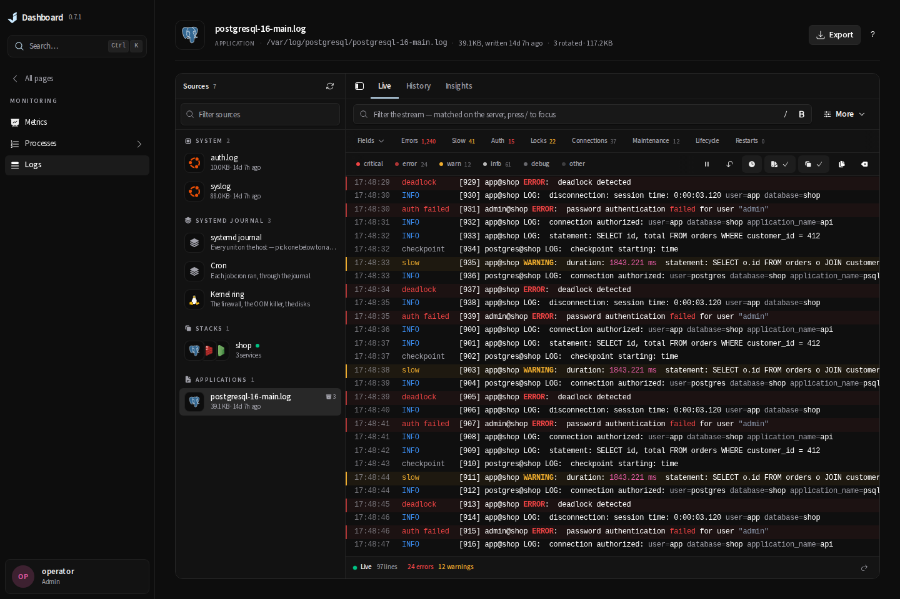 | 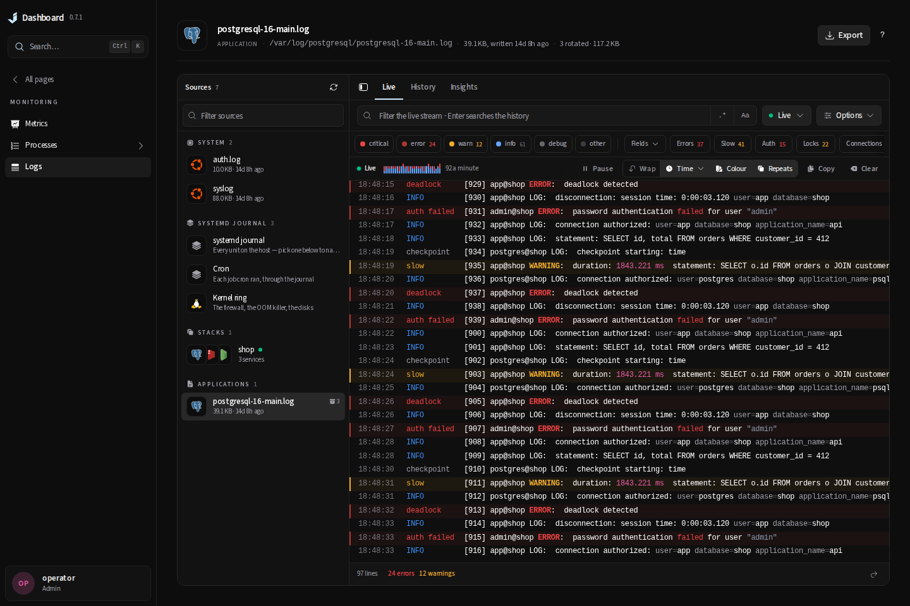 |
| `/logs`, History | 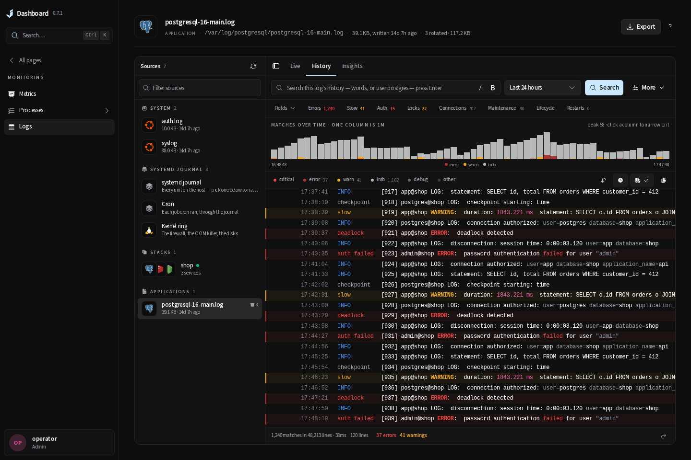 | 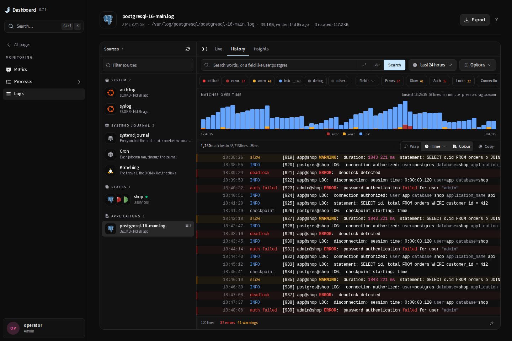 |
| `/logs`, Insights | 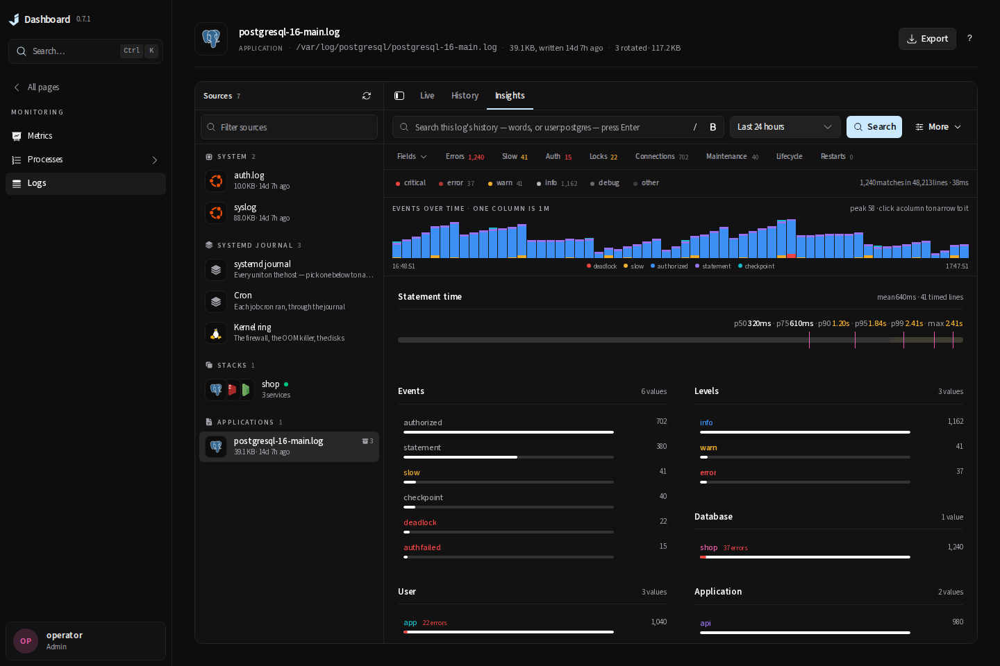 | 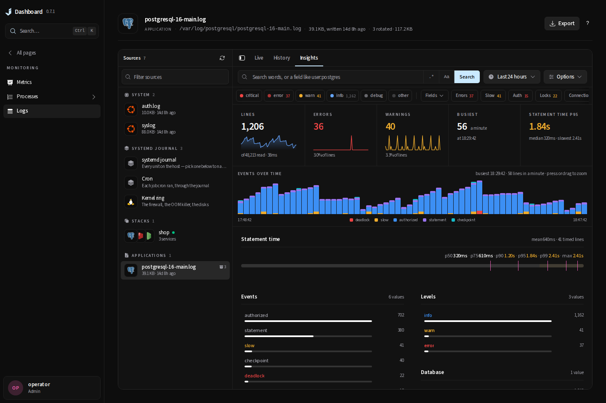 |
| Deployment Insights | 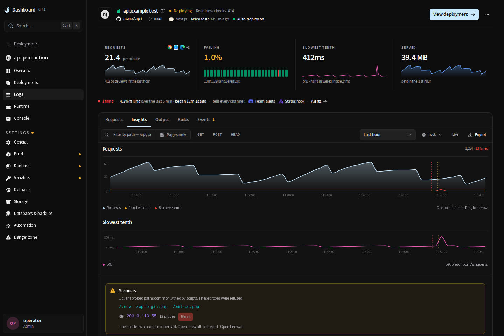 | 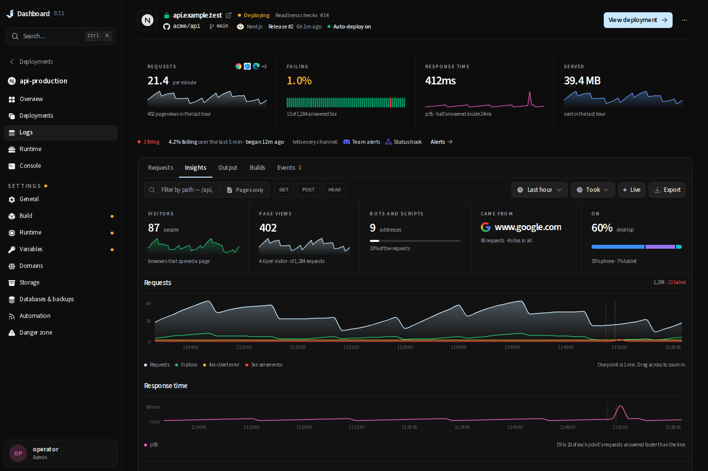 |
| Phone, History | 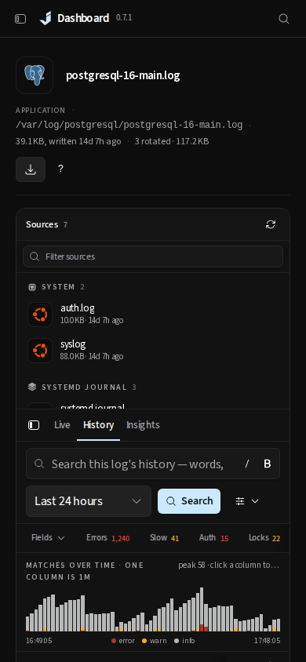 | 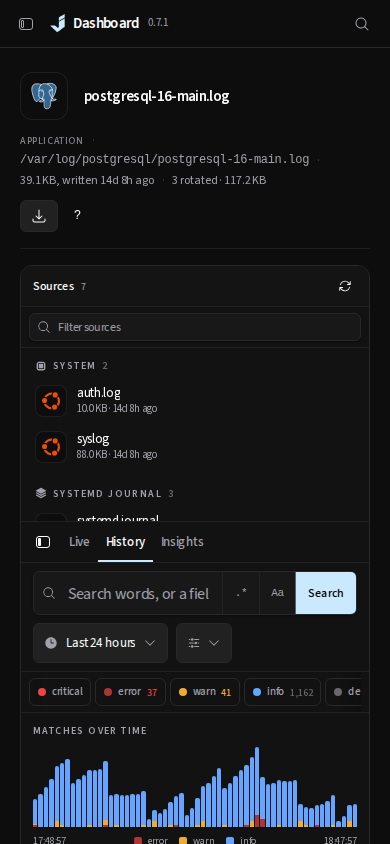 |
| Phone, deployment Insights | 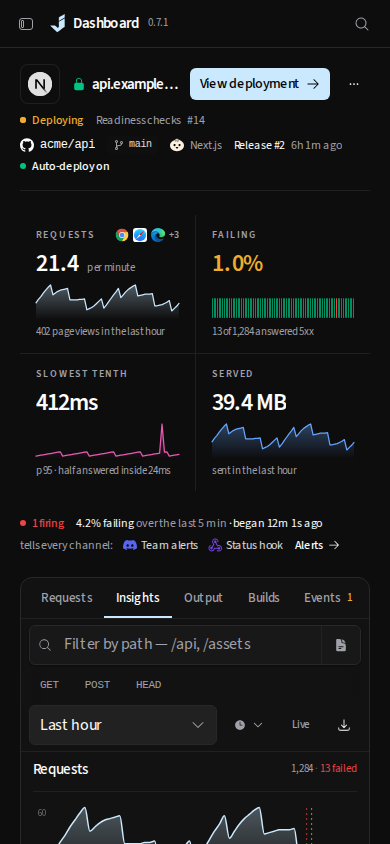 | 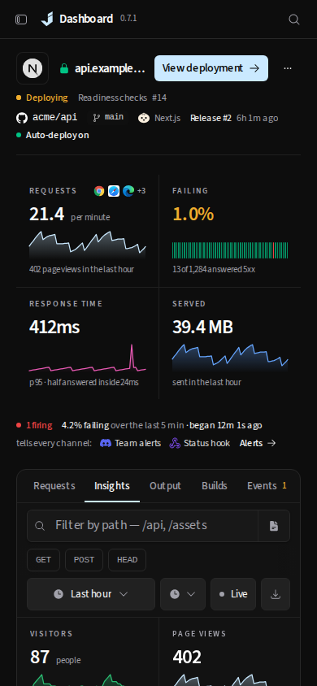 |

After only: [the time window](after-logs-window-1440.png), [Options](after-logs-options-1440.png),
[errors narrowed](after-logs-errors-1440.png), [the visitors' breakdowns](after-deploy-visitors-1440.png),
[the most active visitors](after-deploy-people-1440.png), [the lists under them](after-deploy-lists-1440.png)
and [the DNS page's new log](after-network-dns-log-1440.png).

## Per-page log sources

The audit that preceded this change found every embedded pane fixed to the sources it was built with.
Now: DNS, VPN and Interfaces end on their services' logs (none of the Network pages but Firewall had a
pane); a deployment's Output ends on the proxy that answers for it, narrowed to its hostnames; a site's
page adds its upstream application's log and nginx's shared access log; the engine log keeps host
Caddy's journal beside an ingress and offers Caddy's access log; a container adds its stack and
`docker.service`; panes that mix kinds give each source its own views (Events, Runs). A MySQL slow or
general log is no longer read through the error lens, and known system daemons fall back to the systemd
lens instead of the HTTP application lens.
