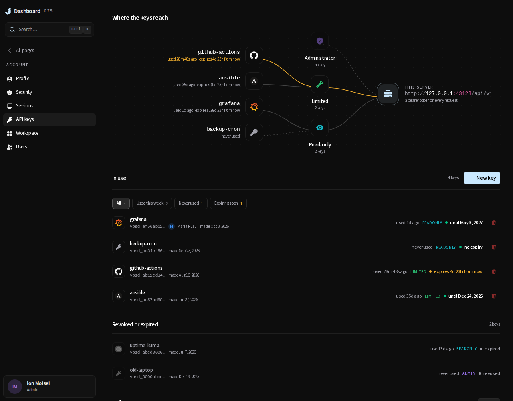
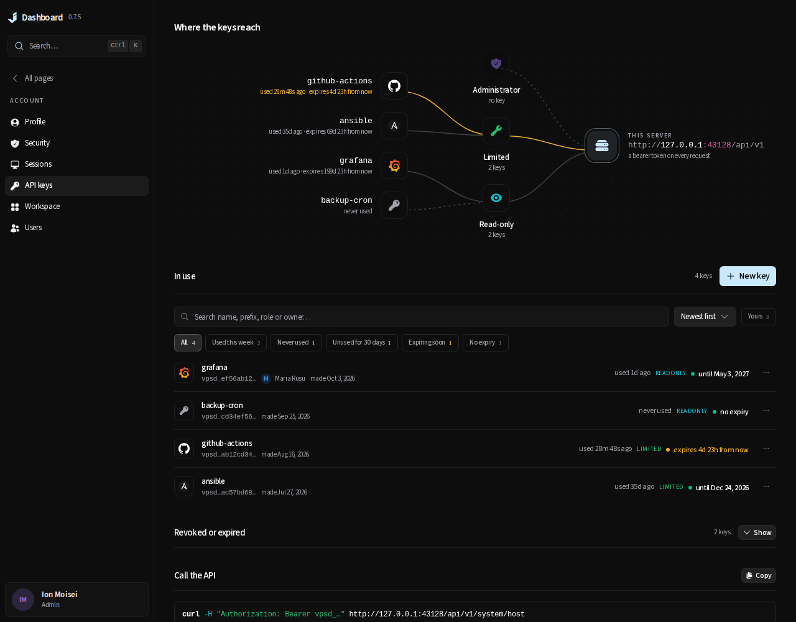
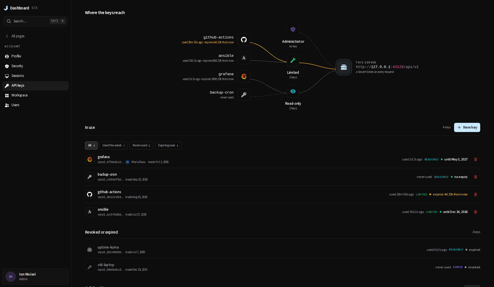
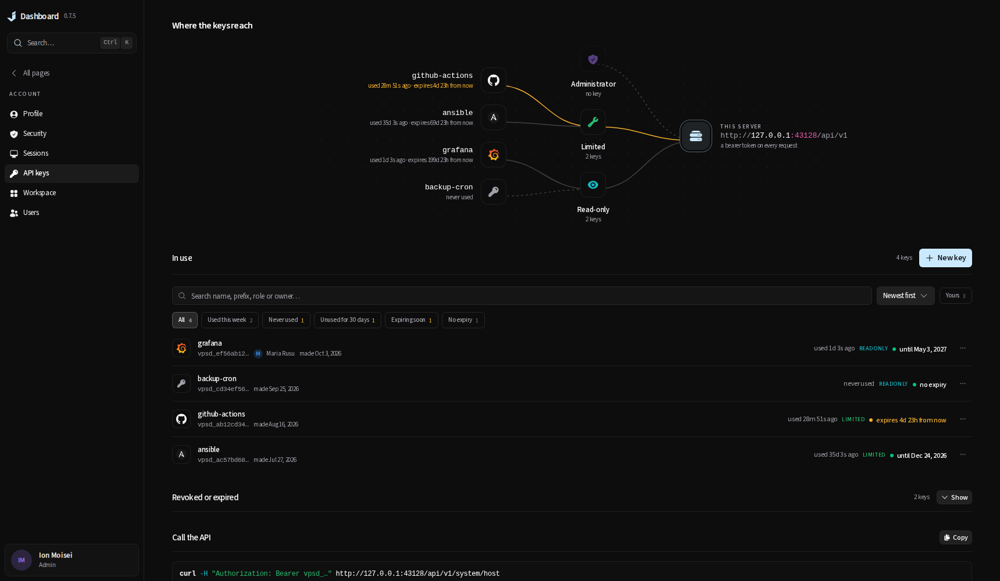
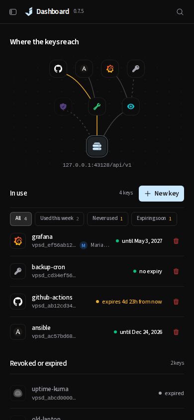
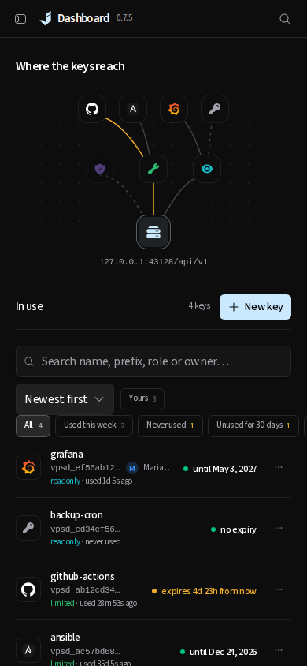
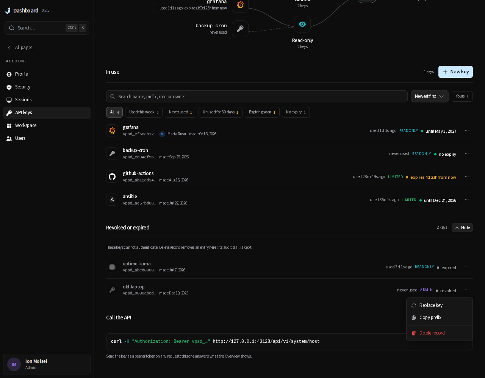
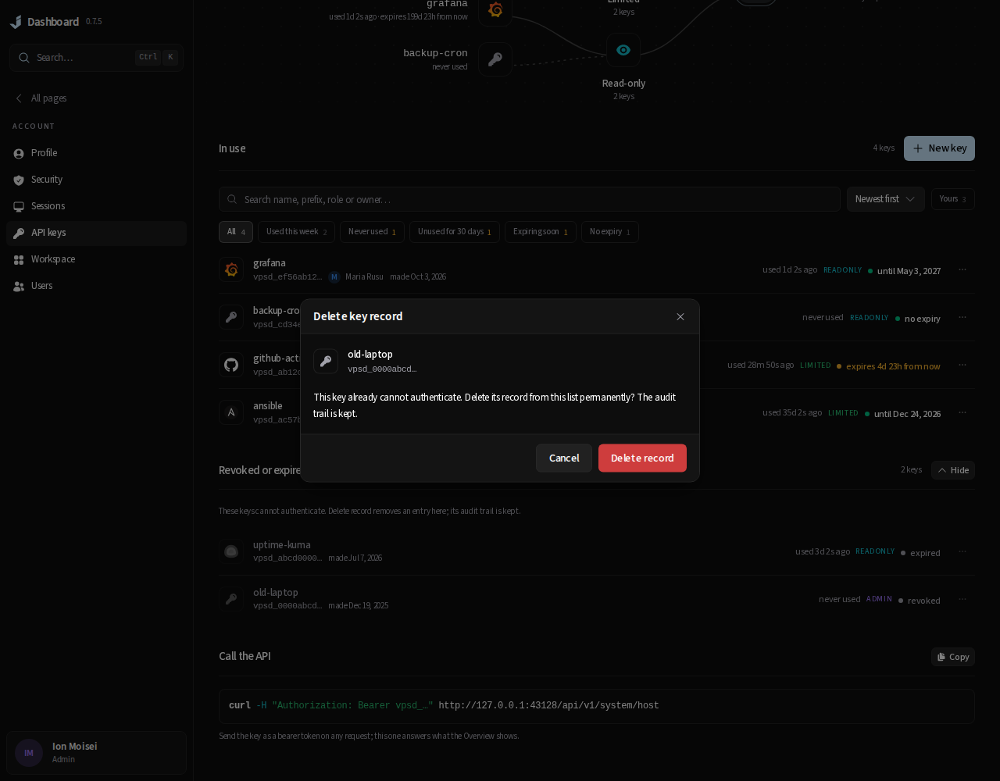
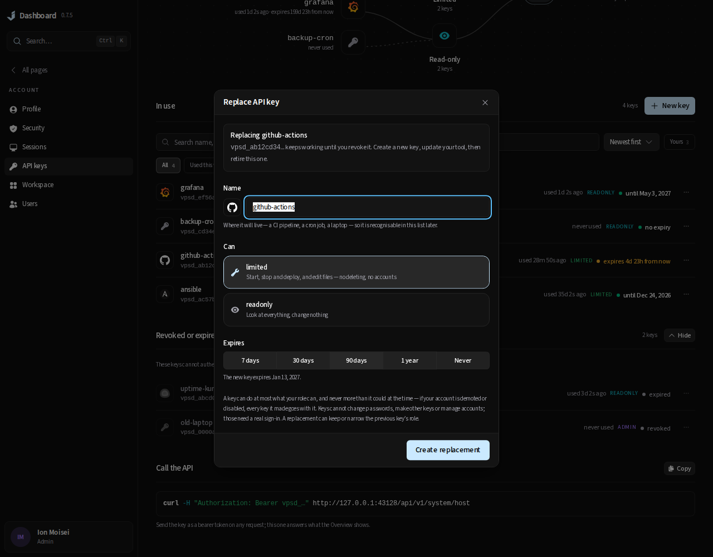
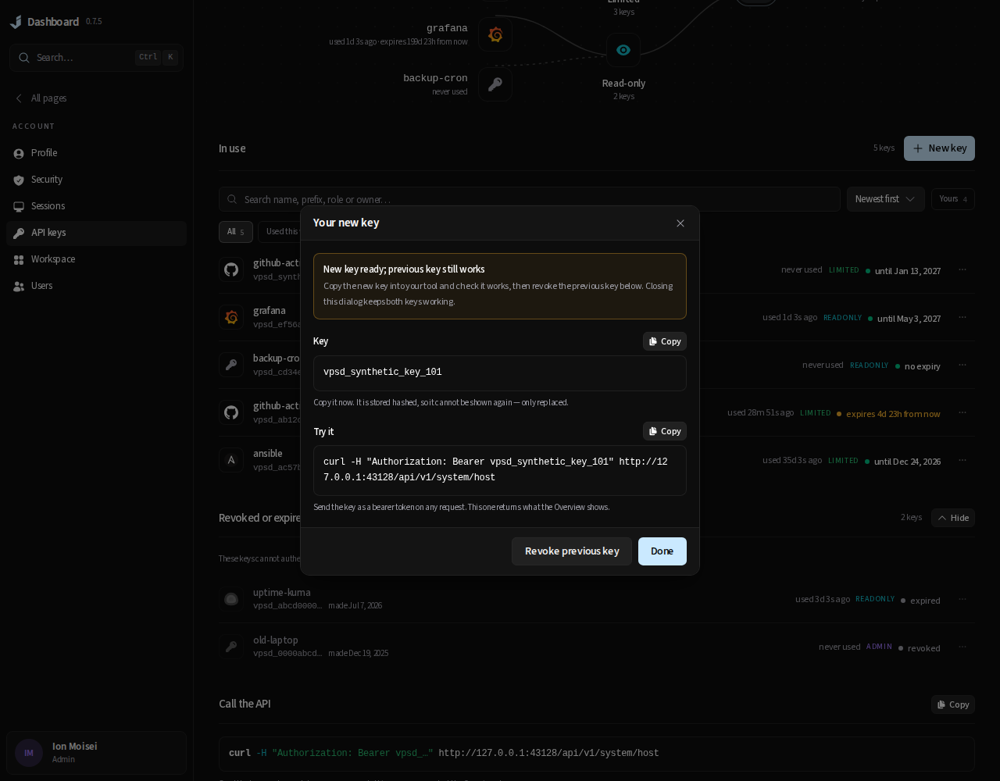

# API key lifecycle and discovery

The account keys page retains the account pages' reading register: the existing product/role wiring
picture, unframed sections, role hues, counted filters and shared row menus. There are no new metric
tiles, decorative cards or shared account-page styling changes.

## Research and decisions

Sources reviewed on 2026-10-15:

- [GitLab personal access tokens](https://docs.gitlab.com/user/profile/personal_access_tokens/)
  separates active and inactive credentials, supports search and rotation, and documents last-use and
  expiry metadata. Its immediate rotation invalidates the old credential. Here, replacement is a
  deliberate handoff instead: mint, copy, update the tool, then explicitly revoke the previous key.
  A failed creation or closing the dialog leaves the previous credential alone.
- [GitHub personal access tokens](https://docs.github.com/en/authentication/keeping-your-account-and-data-secure/managing-your-personal-access-tokens)
  documents expiry and token deletion. This page adds a seven-day lifetime for short jobs, a concrete
  expiry date in the form, a no-expiry warning, and deletion of inactive records as an action separate
  from revocation. Existing no-expiry keys and lifetime defaults are preserved.

The local UI/UX skill's confirmation and feedback guidance informed the separate named actions,
ordinary deletion confirmation, visible progress and failure recovery. Repository design-system
§16 selects the reading register; §15's passes retain plain panels, chip counts rather than tiles,
reading rows, no decorative heading glyphs, existing type and semantic hues, limited arrival motion,
data beside controls and responsive alignment. The final pass uses the changed-file checks and
screenshots at 1280, 1720 and 390 pixels.

## Delivered behavior

- Search names, prefixes, roles and visible owner names. Multiword search requires every word.
  Search also opens matching inactive history. Administrators can narrow to their own keys.
- Sort newest first, by last use, soonest expiry, or name. Missing last-use and expiry dates sort last.
  New filters identify recorded use at least 30 days ago and active keys with no expiry.
- Replace an owned key with a new name/lifetime and an equal or narrower role, capped by the owner's
  current role. Another account's keys cannot be replaced as that account. The existing create and
  revoke API routes enforce ownership and role limits; replacement adds no impersonation endpoint.
- Copy the one-time secret and example command, then optionally revoke the previous key through its
  own confirmation. The dialog stays mounted when the first key changes the page from empty to a
  list. It cannot close or submit again while creation is pending. Done discards its secret.
- Inactive history is folded by default. Revocation keeps the record, while **Delete record** removes
  only inactive metadata. This deletion requires an administrator's browser session and the destructive
  capability/rate budget. A conditional SQL write refuses active credentials, including a stale request.
  Creation, revocation and deletion audit records remain separate and survive record removal.
- Phone rows keep the role and last use visible. Refresh errors identify the retained snapshot and
  provide Retry; failed mutations retain their form or confirmation.

## Images and reproduction

All screenshots use synthetic accounts and credentials from
[`api-keys-fixture.ts`](../../../frontend/tests/browser/api-keys-fixture.ts), with reduced motion.
Before images were captured from the unchanged `a38fc259` frontend build using the same fixture.

| Before | After |
| --- | --- |
|  |  |
|  |  |
|  |  |






[Watch replacement and inactive-record cleanup](replacement-and-cleanup.webm). The credential shown
is synthetic. The recording demonstrates the handoff and separate confirmations; updating an external
tool is the operator’s step between creating the new key and revoking the previous one.

With a production frontend built from this worktree running on loopback:

```bash
JD_BROWSER_BASE_URL=http://127.0.0.1:43128 bun docs/audits/2026-10-15-api-keys/capture.ts after
JD_BROWSER_BASE_URL=http://127.0.0.1:43128 bun docs/audits/2026-10-15-api-keys/record.ts
```

## Validation

- Production `bun run build`: passed, including the frontend type check.
- `JD_BROWSER_BASE_URL=http://127.0.0.1:43128 JD_BROWSER_WORKERS=2 scripts/test-changed.sh patch/0.7.5`:
  passed. Prettier, ESLint and TypeScript passed; 3,620 Bun unit tests and all 159 selected browser
  tests passed; Go build, vet and selected API/auth tests passed. The selector ran account-ui,
  api-keys, auth-recovery, command-search, design-system, navigation, network-confirmation and
  network-native-profile. The final browser run took 4.2 minutes with two workers.
- `go test -race ./internal/auth ./internal/api -run '^(TestDeleteInactiveAPIToken|TestDeleteTokenRecord)' -count=1`:
  passed. `go test -race ./internal/api -run '^TestTokenReplacementHandoff' -count=1`: passed.
- Inspected the final 1280-, 1720- and 390-pixel screenshots, the history menu, replacement handoff
  and deletion confirmation. The capture/record scripts pass the frontend Prettier configuration;
  every local evidence link resolves. All credentials in the images and recording are synthetic.

Browser fixtures prove the UI contract; the Go tests separately exercise real authorization,
conditional deletion, credential resolution and retained audit. The browser checks cover the first
key's refresh, clipboard copy, explicit previous-key revocation, keyboard operation, lower roles,
failed requests, duplicate submission, pending-form locking and responsive overflow.

Pre-push documentation review covered the complete staged diff against `docs/internal/`, `AGENTS.md`,
`README.md` and `CONTRIBUTING.md`. The operator README, internal auth contract, frontend feature map
and documentation index are updated in this change. Existing workflow, security invariants and
verification commands remain accurate, so `AGENTS.md`, `CONTRIBUTING.md` and the other internal
guidance need no edits. No CI, release, licence, dependency or schema changes are included.
