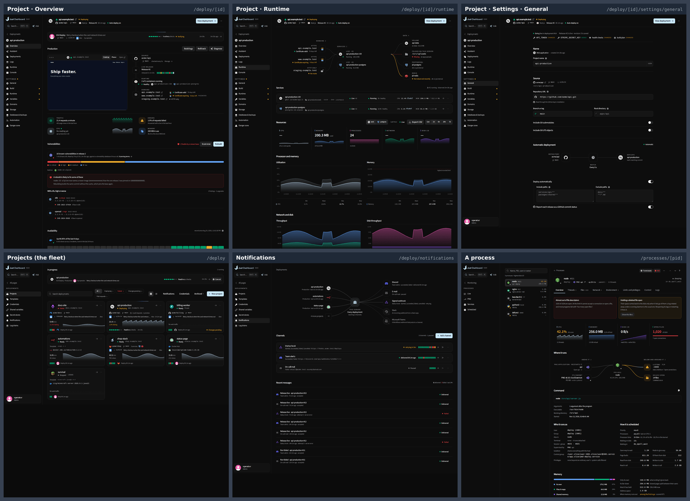
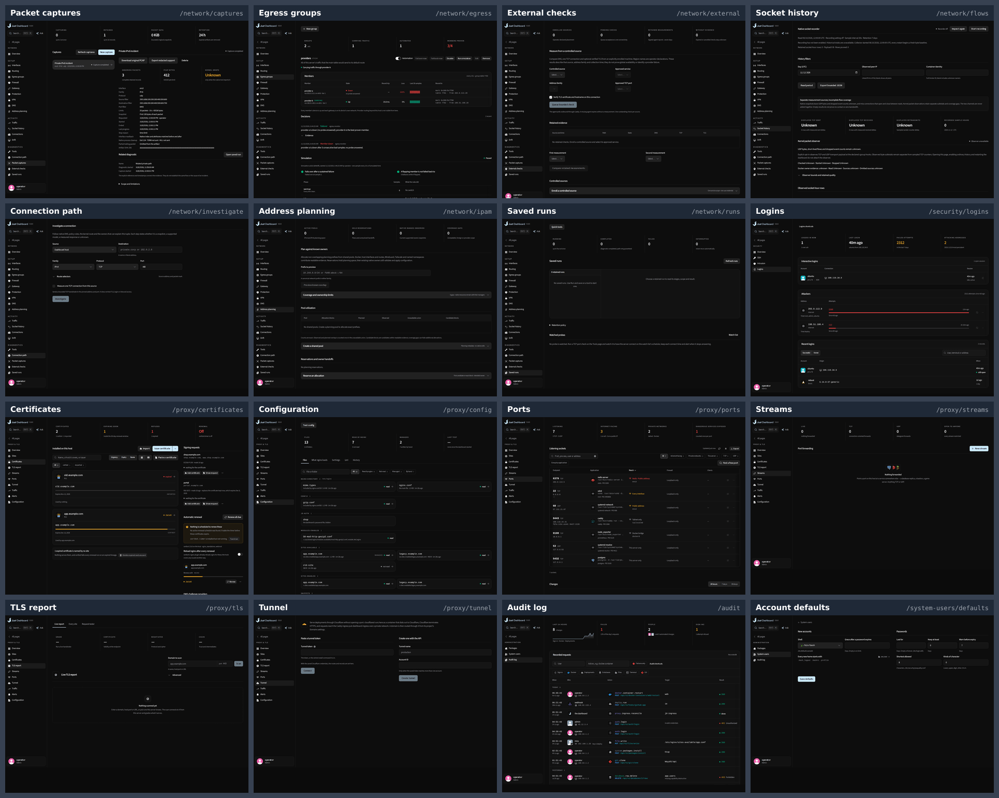
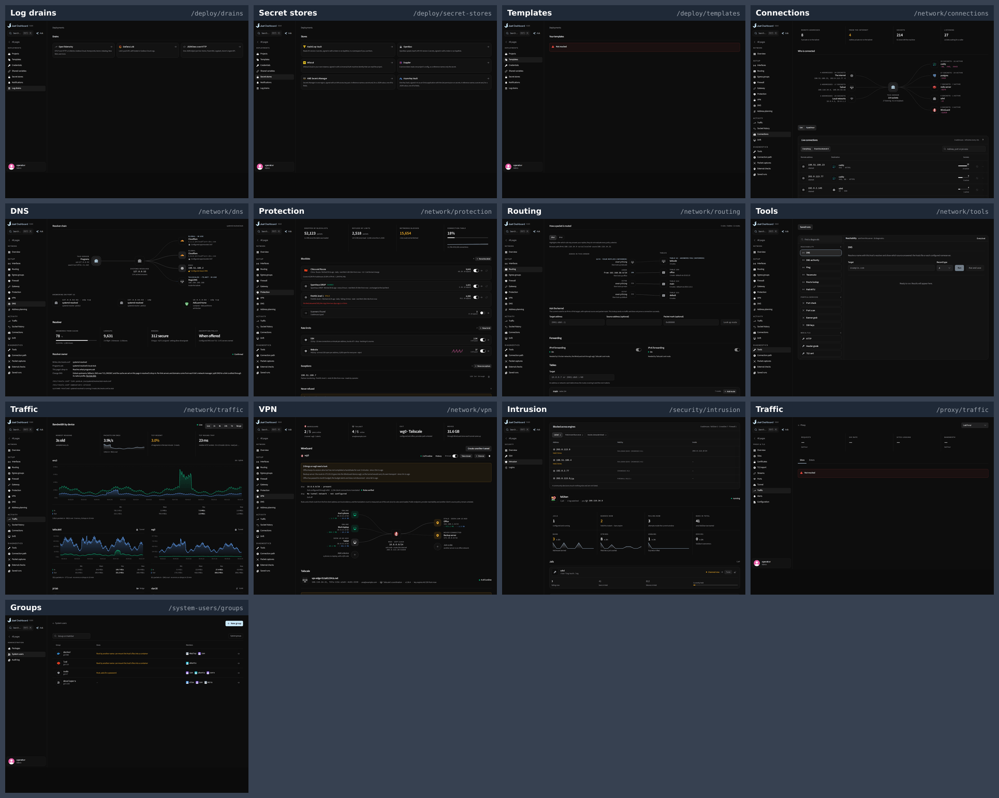

# UI overhaul map

13 November 2026. Read at `88882be07 (main, release 0.8.6)`. A report only: nothing in the product was
changed.

The operator asked which pages are already how they want them, which are still old, what an overhaul
changes, and what is left so that every page reads like the deployment pages, which they like best.
`pages.json` beside this file holds every page's full entry (what is old with file and line, the steps to
reach the standard, its design pull requests).

## The short version

The product has 140 pages. 32 already read like the deploy pages. 77 were overhauled and are close, each with
a short named list of what lags. 31 are still in an older look: 15 half old, and 16 old ones that were built
by feature work and never designed, or were last designed in September.

The old pages sit in three places. Network has 14 of them and Security 2, Proxy and TLS has 7, and the other 8
are spread thin: three deploy pages added in late October, Game settings, the audit log, account defaults,
groups and a volume's link.

Nothing in Databases, Processes, Workspace or Account is old. What is left there is detail: about 50 places
where an item's detail still opens in a side sheet, settings pages that are not in the deploy column, and
several workbenches without the one-pane phone layout.

| State | Pages | Meaning |
| --- | ---: | --- |
| **Done** | 32 | Reads like the deploy pages. Nothing to do beyond a nit. |
| **Close** | 77 | Overhauled in the current look. One to three named things lag. |
| **Half old** | 15 | An earlier pass with newer parts added. Needs a real overhaul, with parts worth keeping. |
| **Old** | 16 | Built by a feature pull request and never designed, or last designed in September. |

| Section | Pages | Done | Close | Half old | Old |
| --- | ---: | ---: | ---: | ---: | ---: |
| Deployments | 27 | 11 | 12 | 4 |  |
| Overview, map and arrival | 6 | 2 | 4 |  |  |
| Databases | 26 | 6 | 20 |  |  |
| Docker | 10 | 2 | 7 | 1 |  |
| Processes | 6 | 5 | 1 |  |  |
| Logs and metrics | 3 |  | 3 |  |  |
| Network | 19 |  | 5 | 7 | 7 |
| Security | 4 |  | 2 | 1 | 1 |
| Proxy and TLS | 11 |  | 4 | 1 | 6 |
| Backups and administration | 9 |  | 6 | 1 | 2 |
| Workspace | 9 | 3 | 6 |  |  |
| Account and settings | 10 | 3 | 7 |  |  |
| **All** | **140** | **32** | **77** | **15** | **16** |

## The standard: what the deploy pages do

| Trait | What it is | Where it lives |
| --- | --- | --- |
| D1 **The page opens on what it is about** | A logo tile, the name, one line of live facts and a state. One brand-faced button at the far right, the rest in a menu. On a project this header is repeated on every page, settings included. | components/deploy/project-shell.tsx (inline, not yet shared); HostIdentity is the shared cousin |
| D2 **A picture first** | The first block draws the thing: what is connected to what, with real logos on the nodes and a line that moves when both ends are up. | components/deploy/wire.tsx (WireNode, WireMark), ui/animated-beam.tsx. Already imported by 45 files outside deploy |
| D3 **Colour and life** | Real product logos, a status dot with its word, one hue per measure with a sparkline, a strip of the last runs, a shimmer on work in flight. | components/product-logo.tsx, status-dot.tsx, outcome-strip.tsx |
| D4 **Readings in words** | A reading is a sentence beside a mark, or one line with a glyph, the reading and its last hour. No row of four grey number tiles opening the page. | ReadingLine in components/deploy/live-readings.tsx:28 (private to deploy today) |
| D5 **Things you open are cards** | One bordered row per thing: logo tile, name over a mono line, state in aligned columns, an arrow at the end. One height in every state; nothing expands in place. | ChoiceRow and ChoiceList in components/flow.tsx |
| D6 **A section is a title and a hairline** | Title left, a count right, the section's one verb as a small button on the title line. No box around the section. | Panel plain in components/panel.tsx |
| D8 **Settings are one centred column** | About 770px wide. Each section has a title, a line of facts with marks, then fields. Switches are full-width rows. One floating save bar, a strip of what is pending, and a dot in the rail on pages with unsaved edits. | components/deploy/settings/setting-card.tsx, save-bar.tsx, segments.tsx, pending-changes.tsx |
| D9 **Detail is a page** | An item's detail has its own address, a header, tabs in the address and, from wide screens, a rail of its siblings. | /processes/[pid] (#440), /processes/services/[unit] (#444), /docker/containers/[id] |
| D10 **Bands, ranks and charts** | A band is one still bar. A ranked list is figures in aligned columns. Latency is in words. A chart has a hue per series and a Min, Mean, Max, Now line under it. | components/bar-reading.tsx, rank-list.tsx, lib/latency-words.ts |
| D12 **One pane on a phone** | A page with several panels shows one full-height pane and a bottom bar. | components/phone-panes.tsx; the Git workspace is the reference |

## What an overhaul changes

Counted in the diffs of 162 design pull requests merged between 23 September and 12 November (frontend/src
only). The three largest rebuilds (#43 deploy, #87 proxy, #99 databases) are left out because their diffs are
whole sections.

**Goes out**

| What | Components | Count | When |
| --- | --- | --- | --- |
| Title bands across the top of a page | `PageHeader` | 65 removed, 1 added | 63 of them in one pull request on 25 September (#46) |
| Metric cards | `StatTile, StatGrid, Metric, StatLink` | 450 removed, 272 added | The steepest fall was 29 September to 10 October: 184 tiles out in 29 pull requests. Then off the project Overview on 2 November (#416) |
| Boxes around sections | `Panel, PanelHeader, PanelBody` | 216 removed, 99 added since 20 October | In early October 468 were added, which is why pages overhauled then are boxier than deploy |
| A bar per row in ranked lists | `BarList, ShareBar` | 57 removed, none added since 20 October | 31 October to 10 November (#411, #418, #442) |
| Attention and findings panels | `FindingList` | 33 removed, 19 added | Mostly mid October (#215) |
| Detail in side sheets | `SidePanel` | 2 moved to pages so far | 9 and 10 November: a process (#440) and a service (#444). About 50 remain |

**Comes in**

| What | Components | Count | When |
| --- | --- | --- | --- |
| Real product logos | `ProductLogo, ProductGlyph` | 471 added | Every period; in at least 73 of the 162 pull requests |
| A status dot with its word | `Status, StatusDot` | 464 added | Every period; in at least 89 pull requests |
| Wiring pictures | `WireNode, WireMark, AnimatedBeam` | 369 added | From the deploy pages on 24 September (#43) onward, in at least 32 pull requests |
| Filter chips with counts, in place of tabs and selects | `FilterChip, ChipCount` | 297 added | September and October |
| An identity line as the page's head | `FactDot, HostIdentity, HostFact` | 273 added | From 23 September |
| Live figures and shimmer on work in flight | `TextShimmer, LiveBytes, LiveFigure` | 255 added | October |
| Cards for things you open or pick | `ChoiceRow, ChoiceCard and their lists` | 164 added | From 23 September |
| The still band | `BarReading` | 39 added | One pull request on 31 October (#411) |
| Ranked lists as figures | `RankList` | 31 added | Four pull requests, 2 to 10 November |

A page overhaul is a pull request of about 2,600 changed lines (the median of the 37 titled Overhaul; the
smallest was 589, the largest 13,526), tests and documents included.

Taste moved while the overhauls ran. Tables were taken out for cards in September and brought back for
readings in October. Frames were added in early October and have been coming out since the 20th. Metric cards
were the rule until 3 October and have been removed since. So a page overhauled between 6 and 10 October
(Docker, Metrics, Packages, Backups, the Network section) is a full step behind a page overhauled in November,
even though both count as overhauled.

The newest moves are the ones least rolled out: detail as a page (two done), the still band and ranked figures
(done where asked), one pane on a phone (four workbenches), a project Overview in sentences (one page).

## Where the overhauls went

Design pull requests merged per week: 21 Sep 31, 28 Sep 30, 5 Oct 45, 12 Oct 20, 19 Oct 14, 26 Oct 8, 2 Nov 9,
9 Nov 8.

| Section | Pages | Design PRs | Latest | Last designed in Nov | 11–31 Oct | 1–10 Oct | Sep | Never |
| --- | ---: | ---: | --- | ---: | ---: | ---: | ---: | ---: |
| Deployments | 27 | 41 | #422, 2 Nov | 8 | 1 | 9 | 4 | 5 |
| Overview, map and arrival | 6 | 19 | #441, 10 Nov | 1 | 2 |  |  | 3 |
| Databases | 26 | 28 | #442, 10 Nov | 4 | 3 | 15 | 1 | 3 |
| Docker | 10 | 27 | #419, 2 Nov | 1 | 7 | 1 |  | 1 |
| Processes | 6 | 11 | #444, 10 Nov | 4 | 1 | 1 |  |  |
| Logs and metrics | 3 | 13 | #419, 2 Nov |  | 2 | 1 |  |  |
| Network | 19 | 8 | #411, 31 Oct |  | 1 | 9 | 2 | 7 |
| Security | 4 | 6 | #215, 13 Oct |  |  | 3 | 1 |  |
| Proxy and TLS | 11 | 19 | #411, 31 Oct |  | 4 | 1 | 5 | 1 |
| Backups and administration | 9 | 12 | #411, 31 Oct |  | 6 | 2 | 1 |  |
| Workspace | 9 | 21 | #412, 31 Oct |  | 6 | 3 |  |  |
| Account and settings | 10 | 9 | #431, 6 Nov | 1 | 7 | 1 | 1 |  |

"Last designed" is the latest design pull request that changed at least 250 lines of the page's own files.
"Never" means a feature pull request built the page and no design pass followed.

## What is left, in order

Sizes: S is a block or two, M is one page in one pull request, L is a page with its detail page, XL is several
pages together.

**Groundwork first**

- **G1 Move ReadingLine out of deploy.** The line that should replace tile rows everywhere (a glyph on a tint,
  a name, the reading in words, its last hour) is a private function in
  components/deploy/live-readings.tsx:28. Export it to components/ first. Every tile-row removal below depends
  on it.
- **G2 Make the project header a shared component.** The deploy header is inline markup in ProjectShell
  (project-shell.tsx). HostIdentity covers some of it. One shared header would give the proxy, network and
  database pages the same opening line.
- **G3 One component for "sources, this server, targets".** Six Network pictures (overview, gateway, VPN, DNS,
  routing, connections) each rebuild the same three-column layout in 250 to 500 lines on top of wire.tsx. A
  shared one makes the pictures the old pages need cheap.
- **G4 Let PendingChanges take any settings form.** The strip that says what is unsaved only accepts a
  deployment's configuration. Database, account and dashboard settings need it too.

### W1 Proxy and TLS: the seven September pages

XL, about five pull requests. The sharpest contrast in the product. The proxy Overview, Sites and a site's
page were overhauled twice in October. Six of these seven came from one September pull request (#87) and
Tunnel from a feature pull request on 29 October (#375). None has a visible header, and each opens on a row of
four grey tiles.

- Give each the Overview's opening: the nginx identity line and a picture.
- Delete the seven tile rows; say the one real reading in the identity line.
- Give a certificate, a stream and a listening port a page each (they are sheets today).
- Put Configuration's and Traffic's views in the address as tabs.
- Reuse the Overview's Install nginx screen where nginx is missing.

Pages: `/proxy/streams` (old), `/proxy/ports` (old), `/proxy/certificates` (old), `/proxy/config` (old),
`/proxy/tunnel` (old), `/proxy/tls` (old), `/proxy/traffic` (half old)

### W2 Network: the seven pages that never had a design pass

XL, three or four pull requests. Built by the network capability pull request (#173, 10 October) as tiles, a
paragraph, a form and a table. They share three layouts, so they can go together.

- Packet captures and Saved runs: a list of cards, and a page for one capture or run.
- External checks, Address planning and Socket history: one evidence-page shape with a picture, no tile row
  and no opening paragraph.
- Connection path: fold the form into Tools and draw the result as a wiring chain.
- Egress groups: cards that open a group's page.

Pages: `/network/captures` (old), `/network/runs` (old), `/network/external` (old), `/network/ipam` (old),
`/network/flows` (old), `/network/investigate` (old), `/network/egress` (old)

### W3 Network: the seven half-old pages

XL, one pull request a page. These already have deploy's wiring pictures. What is old is around them: a tile
row that repeats the picture, no identity line, settings inline in two columns, detail in sheets.

- Start with Connections: all four of its tiles repeat figures already on the page.
- Give each an identity line.
- Move inline settings (DNS upstreams, Protection's kernel settings, Traffic budgets) into the settings
  column.
- Give an interface, a tunnel and a peer a page.

Pages: `/network/connections` (half old), `/network/vpn` (half old), `/network/protection` (half old),
`/network/dns` (half old), `/network/traffic` (half old), `/network/routing` (half old), `/network/tools`
(half old)

### W4 Security: Logins and Intrusion

L. Logins was last designed on 27 September and is tiles over three framed tables. Intrusion stacks three
engines and fifteen tiles into one very long page.

- Logins: an identity line, a picture of who got in and from where, ranked lists as figures.
- Intrusion: one engine at a time behind tabs in the address, no tile stacks.

Pages: `/security/logins` (old), `/security/intrusion` (half old)

### W5 Administration: audit log, account defaults, groups

M each. The audit log was last designed on 25 September: no header, four tiles, one table. Defaults is a plain
two-column form from a feature pull request. Groups is a small table with its detail in a sheet.

- Audit log: a header, the day in a sentence, the tiles gone.
- Defaults: the settings column with one save bar.
- Groups: cards, and a page for a group.

Pages: `/audit` (old), `/system-users/defaults` (old), `/system-users/groups` (half old)

### W6 Deploy's own stragglers

M each. Added by feature pull requests between 26 and 30 October. No picture, rows of two or three lines of
text with a grey tag, no state column. Notifications, next to them in the rail, has all three.

- Copy Notifications: a picture first, one-line rows with a state column and a strip of recent results.
- Game settings: move it onto the settings page shape so it gets the pending strip and the facts line.
- Add test fixtures with data for these pages; every capture of them today is an empty state.

Pages: `/deploy/drains` (half old), `/deploy/secret-stores` (half old), `/deploy/templates` (half old),
`/deploy/[id]/game-settings` (half old)

### W7 Detail sheets to pages

L each, one at a time. The process and service pages set the shape on 9 and 10 November. About 50 sheets
across the product still hold an item's detail. These ten pages hold the heaviest.

- PM2 first: the newest process page links straight into its old two-tab sheet.
- A volume: /docker/volumes/[name] exists but only redirects to the sheet. Make it the page.
- Then an image, a Docker network, a package.
- A proxy site's editor is a 4,280-line sheet; it should be Settings tabs on the site's page.
- A database statement, table and account; a network interface.

Pages: `/processes/pm2` (close), `/docker/volumes/[name]` (half old), `/docker/volumes` (close),
`/docker/images` (close), `/docker/networks` (close), `/packages` (close), `/proxy/sites/[name]` (close),
`/databases/[id]/performance` (close), `/databases/[id]/access` (close), `/network/interfaces` (close)

### W8 Settings in the deploy column

S to M each. These have the new pictures and logos but lay settings out full width or two columns, with helper
text under fields. The database settings already use deploy's column and save bar, but many changes go round
the bar through their own dialogs, and there is no pending strip.

- One centred column and one save bar on each.
- Helper text under fields becomes an (i) tip.
- Database settings: add the pending strip; route the address, exposure, parameter and TLS changes through the
  bar.

Pages: `/dashboard/configuration` (close), `/account` (close), `/account/security` (close),
`/account/workspace` (close), `/dashboard/hub` (close), `/databases/[id]/settings` (close),
`/databases/[id]/settings/network` (close), `/databases/[id]/settings/parameters` (close),
`/databases/[id]/settings/pooling` (close), `/system-users/user/[name]` (close)

### W9 Databases: the shared leftovers

M, two or three pull requests. Nothing here is old, but the same few things recur: figure tiles on
control-center cards, the Schema head and the Import steps; a bar under each row on Performance's Statements,
Tables and Indexes; the same four charts on Home and on Performance.

- Decide the header once: every page under a database except Home opens on a one-line strip, where deploy
  repeats its full header.
- Remove the remaining tiles and per-row bars.
- Home reads its measures as lines with sparklines; the charts stay on Performance.

Pages: `/databases` (close), `/databases/[id]` (close), `/databases/[id]/schema` (close),
`/databases/[id]/data` (close), `/databases/[id]/import` (close), `/databases/[id]/alerts` (close),
`/databases/[id]/backups` (close)

### W10 One pane on a phone

M each. Only Git, the assistant, Logs and Network tools have the one-pane layout with a bottom bar. Files
wraps its toolbar to three rows, the terminal lays its rail over the screen.

- Put each on components/phone-panes.tsx, as the Git workspace is.

Pages: `/files` (close), `/files/editor` (close), `/terminal` (close), `/remote-desktop/[id]` (close),
`/databases/[id]/data` (close), `/databases/[id]/query` (close), `/deploy/[id]/logs` (close)

### W11 When something is not installed

S to M. The proxy Overview has a designed setup screen with an Install button. Elsewhere a missing Docker,
systemd or nginx is a grey sentence, a red box or the daemon's raw error.

- One designed screen per missing thing, with its logo and the next step, used on every page that needs it.

Pages: `/docker` (close), `/processes/services` (done), `/processes/services/[unit]` (done), `/logs` (close),
`/proxy/streams` (old), `/proxy/config` (old), `/proxy/traffic` (half old), `/map` (close)

### W12 The long tail on pages that are close

S each. The other pages marked Close each have one to three small things, listed under the page in the map.

- Take them a section at a time when a section is otherwise finished.

## Every page

### Deployments

| State | Page | Route | Last designed | Size | What lags |
| --- | --- | --- | --- | --- | --- |
| Half old | Project · Game settings | `/deploy/[id]/game-settings` | 24 Sep, #43 | M | Built on FormSections instead of SettingsPage/SettingSection, so it has no PendingChanges strip, no LastFailureRemedy and no facts line with marks; all settings sit in one section. |
| Half old | Log drains | `/deploy/drains` | never; built 26 Oct, #326 | M | No picture. Notifications, its neighbour in the rail, opens on projects -> this server -> channels; drains have exactly that shape (projects -> server -> OTLP/Loki/HTTP endpoints) and draw none. |
| Half old | Secret stores | `/deploy/secret-stores` | never; built 27 Oct, #338 | M | No picture of what a store feeds: stores -> this server -> the variables and projects that read them; the reach is a run-on sentence in the row. |
| Half old | Templates | `/deploy/templates` | never; built 30 Oct, #386 | M | A template row is three description lines tall (id · v1 · from Compose by alice, 2d ago / images in mono / used by 2 deployments) with the kind as a grey Tag; not one line with state in columns. |
| Close | Project · Console | `/deploy/[id]/console` | 4 Oct, #120 | S | Without a runtime the page is a grey warning Notice printing the daemon's reason ('Docker runtime evidence could not be loaded...') and a small outline button; without the capability another grey Notice. |
| Close | Project · Deployments | `/deploy/[id]/deployments` | 2 Nov, #417 | S | The 'history' presentation of Insights opens on four bare figures with captions (75% / 2.1 / 1m 35s / 1.5h) where the Overview's own presentation of the same data is a sentence on the source mark ('9 of 12 releases succeeded in the last 30 days...'). |
| Close | Project · Logs | `/deploy/[id]/logs` | 11 Oct, #199 | M | The page opens on a StatGrid of four tiles restating what the Overview already says as two ReadingLines (Traffic 21.4 requests a minute; Errors 1.0% of requests failed). |
| Close | Project · Players | `/deploy/[id]/players` | 24 Sep, #43 | S | No player adapter or a partial list shows a grey/amber Notice printing the backend's reason. |
| Close | Project · A run | `/deploy/[id]/runs/[run]` | 5 Oct, #142 | S | A replay step's report is a StatGrid of four bare tiles (Replayed, Drifted, Candidate p95 within, Took). |
| Close | Project · Settings · Build | `/deploy/[id]/settings/build` | 4 Oct, #116 | S | Migration rehearsal's switch carries a four-line paragraph ('Before they run against production, the release tasks run against a copy restored from the database's newest backup...'). |
| Close | Project · Settings · Danger | `/deploy/[id]/settings/danger` | 24 Sep, #43 | S | The lifecycle StageStrip sits in the narrow facts slot and truncates its labels to 'Arch...' and 'Dele...'. |
| Close | Project · Settings · Databases | `/deploy/[id]/settings/databases` | 4 Oct, #116 | S | 'Latest backup gate evidence' with nothing recorded is a grey sentence ('The latest run did not execute a backup policy.') ending the page. |
| Close | Project · Settings · Runtime | `/deploy/[id]/settings/runtime` | 4 Oct, #116 | M | Traffic replay's switch hint is a four-line paragraph. |
| Close | Project · Settings · Storage | `/deploy/[id]/settings/storage` | 24 Sep, #43 | S | Persistent mounts has no facts line under its title (General's Source has 'acme/api · main · a12bc34'); the section opens straight on field labels repeated per row ('Source', 'Container path'). |
| Close | New project | `/deploy/new` | 5 Oct, #144 | M | The source step has no picture: GitHub App 'Disconnected · Connect' is a text row, where Credentials draws the same connection as a wiring picture. |
| Close | Shared variables | `/deploy/variables` | 2 Nov, #421 | S | No picture of what a server variable reaches; the readers are a 'Read by 3' popover per row, where Notifications and Credentials draw the server between its sources and its readers. |
| Done | Projects (the fleet) | `/deploy` | 2 Nov, #416 |  |  |
| Done | Project · Overview | `/deploy/[id]` | 2 Nov, #417 |  |  |
| Done | Project · Assistant | `/deploy/[id]/assistant` | never; built 2 Nov, #423 |  | A failed read is a red Notice printing the raw error message ('Not mocked' in the fixture), not a designed state with the next step. |
| Done | Project · Runtime | `/deploy/[id]/runtime` | 2 Nov, #419 |  | Nit: the Resources head is a StatGrid of five tiles (CPU, Memory, Processes, Network, Disk I/O); allowed because each carries a hue and a sparkline, but CPU and Network read a bare em dash when idle. |
| Done | Project · Settings (redirect) | `/deploy/[id]/settings` | never |  |  |
| Done | Project · Settings · Automation | `/deploy/[id]/settings/automation` | 2 Nov, #421 |  |  |
| Done | Project · Settings · Domains | `/deploy/[id]/settings/domains` | 2 Nov, #422 |  | Nit: several switches carry a two-line paragraph under their label (HSTS: 'Tells browsers never to use plain HTTP... Hard to undo'; Require sign-in: 'Every request is checked with Authelia, Authentik...'; Maintenance: 'Every visitor gets the maintenance page with a 503...'). |
| Done | Project · Settings · General | `/deploy/[id]/settings/general` | 3 Oct, #113 |  |  |
| Done | Project · Settings · Variables | `/deploy/[id]/settings/variables` | 2 Nov, #421 |  |  |
| Done | Credentials | `/deploy/credentials` | 3 Oct, #106 |  |  |
| Done | Notifications | `/deploy/notifications` | 2 Oct, #101 |  |  |

### Overview, map and arrival

| State | Page | Route | Last designed | Size | What lags |
| --- | --- | --- | --- | --- | --- |
| Close | Overview | `/` | 19 Oct, #279 | M | Services closes the page on a StatGrid of eight figure tiles (Docker 9 running, Proxy 3 certificates, Security 'Tailscale only', Packages 7 updates, System services 1 failed, Git 4, Remote desktop 2, Settings 'Up to date') the reader has to turn into sentences. |
| Close | Page not found | `/[...missing]` | never; built 30 Oct, #403 | S | A generic EmptyState with a question glyph; no picture and no route-aware next step (for /deploy/99 the list of projects, for an old address the page it moved to). |
| Close | Assistant | `/assistant` | never; built 2 Nov, #423 | S | Settings view frames ordinary sections as Panels (Providers, What it may do on its own, Where it works, Ask about a deployment). |
| Close | Server map | `/map` | 10 Nov, #441 | S | Failed reads are pills over the canvas printing the raw daemon error ('Containers not read: Cannot connect to the Docker daemon at unix:///var/run/docker.sock. Is the docker daemon running?'), four stacked, covering the diagram. |
| Done | Sign in | `/login` | never; built 23 Sep, #38 |  | Nit: two helper paragraphs under the form (passkeys need the host name; allowlist and recorded attempts). |
| Done | First-run question | `/welcome` | 14 Oct, #224 |  |  |

### Databases

| State | Page | Route | Last designed | Size | What lags |
| --- | --- | --- | --- | --- | --- |
| Close | Control center | `/databases` | 10 Nov, #441 | M | The identity line ends in four equal controls besides the brand button: 'Metrics export' and 'MCP server' as grey outline buttons, a refresh icon, then 'Add a database'. Deploy keeps one brand-faced command and puts the rest in a ⋯ menu. The facts line also wraps with a dangling separator ('read by 4 ·'). |
| Close | Database · Home | `/databases/[id]` | 10 Nov, #441 | M | The 'Activity' block is the same four full-size charts (Sessions, Throughput, Rows, Cache) that Performance → Overview draws again from the same component. Deploy's Overview reads its measures as compact ReadingLines (glyph, reading, sparkline) and leaves the charts to Runtime. |
| Close | Database · Access | `/databases/[id]/access` | 2 Oct, #105 | L | An account's arrow opens an lg SidePanel (AccountSheet) holding its facts and the whole grants editor (access-grants.tsx, 937 lines). That is rich detail and a large editor in a sheet over the list. Mongo and Redis accounts do the same. |
| Close | Database · Alerts | `/databases/[id]/alerts` | 24 Sep, #43 | S | A rule is a plain row, not a bordered ChoiceRow. Its height depends on its kind: Disk and Connections rows carry a meter and a sentence, Server down has neither, Backup missed has a third line. |
| Close | Database · Backups | `/databases/[id]/backups` | 2 Oct, #99 | M | The dumps table wraps every cell to two lines (2h 3s ago / by operator, file / note, Everything / pg_dump 16.12, 1.0 MB / under a second), and the per-row icon actions have no labels. |
| Close | Database · Data | `/databases/[id]/data` | 2 Oct, #99 | M | With no table open, the landing opens on a MetricStrip of counts per object kind plus Rows and On disk tiles. |
| Close | Database · Diagram | `/databases/[id]/diagram` | 2 Oct, #99 | S | Its chrome is its own, not the server map's: zoom buttons in a small card at the top left, and a React Flow MiniMap at the bottom right. /map and /databases/map have a bottom zoom bar (−, %, +, Fit, All) and a keycap legend (F Fit · I Panel · ↵ Open · Esc Let go). |
| Close | Database · Generate | `/databases/[id]/generate` | 2 Oct, #99 | S | The empty state is two lines of explanation ('A schema.prisma to drop into an existing Prisma project. Generate reads the catalogue and writes schema.prisma for you to review; nothing in the database is changed.'). |
| Close | Database · Import | `/databases/[id]/import` | 18 Oct, #277 | S | The Plan step opens on a StatGrid of four bare tiles (Tables, Rows, Size, Sequences). |
| Close | Database · Logs | `/databases/[id]/logs` | 2 Oct, #99 | S | A top statement opens in a SidePanel with a seven-tile MetricStrip (Of runtime, Calls, Total, Mean, Slowest run, Rows, From cache). |
| Close | Database · Performance | `/databases/[id]/performance` | 10 Nov, #441 | L | Statements draws a 4px bar under every statement's text, scaled to the busiest one: a ranked list with a bar per row. #442 removed this from the home but not here. Tables and Indexes do the same inside their rows. |
| Close | Database · Query | `/databases/[id]/query` | 2 Oct, #99 | S | Two bars of chrome above the editor (identity strip, then the frame's tab row), and a run bar of seven equal grey controls in the middle of the frame. The Git workspace has one head bar and a single primary command. |
| Close | Database · Schema | `/databases/[id]/schema` | 2 Oct, #99 | S | The table head opens on a strip of four figure tiles (ROWS ~9,000 · SIZE 3.2 MB · DATA·INDEXES with a two-tone bar · OWNER app). |
| Close | Database · Search | `/databases/[id]/search` | 2 Oct, #99 | S | An amber Notice with a full paragraph ('The search stops at 60 tables, 5 rows from each and 200 rows in all. Open a table below to see every row of it that matches, tick the tables to read, or search a narrower value.') sits above every result, plus a 'Not read — usually for want of a permission' line. |
| Close | Database · Settings · General | `/databases/[id]/settings` | 16 Oct, #240 | S | Compared with deploy__id__settings__general: deploy repeats the full identity header (40px logo tile, name, facts line, brand 'View deployment', ⋯) on every settings page. The database settings pages have the one-line IdentityStrip (small mark, switcher, muted facts, Connect, ⋯). |
| Close | Database · Settings · Extensions | `/databases/[id]/settings/extensions` | 2 Oct, #99 | S | Every extension gets a grey category glyph (table, terminal, trend). Product logos are only used as a fallback in the dialogs, so pg_stat_statements, PostGIS and pgvector read alike. |
| Close | Database · Settings · Network | `/databases/[id]/settings/network` | 16 Oct, #240 | M | The exposure choice is a 2×2 grid of ChoiceCards, each with a two-line explanation ('Port 5432 on loopback. Programs on this machine and the deployments linked to it reach it; nothing else does.'). Pressing one starts a review and confirm at once, outside the save bar. Deploy uses Segments or full-width switch rows for a small choice, saved by the bar. |
| Close | Database · Settings · Parameters | `/databases/[id]/settings/parameters` | 2 Oct, #99 | S | An amber Notice ('1 parameter is stored and not yet in effect / It takes effect when the server is restarted.') restates the title-line status. |
| Close | Database · Settings · Pooling | `/databases/[id]/settings/pooling` | 2 Oct, #99 | M | Paragraphs under Pool mode, Authentication and the size fields, a further paragraph on max_connections, and a three-line paragraph under 'Where it is reached'. |
| Close | Database · Settings · Version | `/databases/[id]/settings/version` | 2 Oct, #99 | S | The upgrade section is a numbered list of four long sentences explaining the procedure (dump, start beside it, read-only window, keep the old one). |
| Done | Database · Page not found | `/databases/[id]/[...missing]` | never; built 2 Oct, #99 |  |  |
| Done | Database · Assistant | `/databases/[id]/assistant` | never; built 4 Nov, #428 |  | Sits under the compact identity strip rather than a full header; the deploy assistant page has the full identity header. |
| Done | Database · Settings · Danger | `/databases/[id]/settings/danger` | 2 Oct, #99 |  |  |
| Done | Database · Settings · Resources | `/databases/[id]/settings/resources` | never; built 17 Oct, #252 |  | Compact identity strip instead of deploy's settings header (shell-wide, see General). |
| Done | Databases map | `/databases/map` | 10 Nov, #441 |  | At 390px only the canvas is drawn, cut off at the right edge. The rail of databases, the inspector and the zoom bar are gone, and there is no bottom bar to reach them. It inherits this from the shared map canvas. |
| Done | Add a database | `/databases/new` | 2 Oct, #103 |  |  |

### Docker

| State | Page | Route | Last designed | Size | What lags |
| --- | --- | --- | --- | --- | --- |
| Half old | A volume (redirect) | `/docker/volumes/[name]` | never; built 10 Oct, #181 | L | The route exists only so deployment links can address a volume; it redirects into the SidePanel. |
| Close | Docker overview | `/docker` | 31 Oct, #411 | M | The first block is three bands and the second is the same 12-row container table /docker/containers draws; nothing pictures the engine (stacks to containers to networks and volumes) as the deploy Overview or the container page's 'Reached at / Keeps' wiring does. |
| Close | Events | `/docker/events` | 10 Oct, #180 | S | The event feed (a list of sentences, not a table) sits in a framed Panel. |
| Close | Images | `/docker/images` | 31 Oct, #411 | L | An image's detail (layers, tags, containers, history) opens in an xl SidePanel over the table, where containers and stacks have pages. |
| Close | Networks | `/docker/networks` | 31 Oct, #411 | L | A network's detail (members, IPAM, traffic) opens in a SidePanel. |
| Close | Stacks | `/docker/stacks` | 31 Oct, #411 | M | Each stack is a collapsible group row whose services expand in place under it and push the rest down; the Docker Overview draws the same stacks as ChoiceRow cards that open the stack page. |
| Close | A stack | `/docker/stacks/[name]` | 31 Oct, #411 | M | Opens on the services table; the wiring picture ('Ports and networks') is the last block of the Overview. |
| Close | Volumes | `/docker/volumes` | 31 Oct, #411 | L | A volume's detail, including a full inline Files browser, opens in an xl SidePanel; /docker/volumes/[name] only redirects back to ?volume= to open that sheet. |
| Done | Containers | `/docker/containers` | 31 Oct, #411 |  | Titled 'Docker Engine 29.2.0' where the Overview, Images, Volumes and Networks say 'Docker 29.x'. |
| Done | A container | `/docker/containers/[id]` | 2 Nov, #419 |  | No rail of sibling containers from xl, which the newer process and service pages (#440, #444) have; the page is otherwise their equal. |

### Processes

| State | Page | Route | Last designed | Size | What lags |
| --- | --- | --- | --- | --- | --- |
| Close | PM2 | `/processes/pm2` | 31 Oct, #411 | L | An application's detail is PM2DetailSheet, a SidePanel with Overview and Logs tabs; the process page it should match has a rail, eight ?tab= views and a wiring picture. The process page's 'Open api' link (procs/shared.ts:36) sends the reader from the newest page into this sheet. |
| Done | Processes · Live | `/processes` | 6 Oct, #163 |  | Matches the Services list except for two Selects ('All users', 'Automatic focus') on the panel title line where Services uses chips only, and no Recent band. |
| Done | A process | `/processes/[pid]` | 10 Nov, #444 |  |  |
| Done | Scheduled | `/processes/scheduled` | 9 Nov, #439 |  | Timers without systemd read a bare grey EmptyNote. |
| Done | Services | `/processes/services` | 10 Nov, #444 |  | Without systemd the page is a glyph and one grey sentence, 'systemd is not available on this host', with no next step. |
| Done | A service | `/processes/services/[unit]` | 10 Nov, #444 |  | Without systemd the page shows a red ErrorState paragraph and the rail says 'No service matches.' (sandbox capture). |

### Logs and metrics

| State | Page | Route | Last designed | Size | What lags |
| --- | --- | --- | --- | --- | --- |
| Close | Logs | `/logs` | 10 Oct, #188 | S | An absent source kind prints the backend's words; on a server without Docker the rail reads 'Cannot connect to the Docker daemon at unix:///var/run/docker.sock. Is the docker daemon running?' (sandbox desktop-dark/logs.png). |
| Close | Metrics | `/metrics` | 11 Oct, #194 | S | Memory 'Allocation' is a bar with three tile-like figures (PROGRAMS/CACHE/FREE) under it, the rows-under-a-bar shape #411 replaced elsewhere with BarReading. |
| Close | Host alerts | `/metrics/alerts` | 25 Oct, #313 | S | No identity header: only a 'Metrics' breadcrumb over the picture; Check now and Add rule sit on section lines. |

### Network

| State | Page | Route | Last designed | Size | What lags |
| --- | --- | --- | --- | --- | --- |
| Old | Packet captures | `/network/captures` | never; built 10 Oct, #173 | M | Page opens on a StatGrid at y=32: Capturing 0, Retained 1 (the list has one row), Packet data 0 KiB, Retention 24 h (a policy, not a reading). |
| Old | Egress groups | `/network/egress` | never; built 10 Oct, #173 | L | StatGrid of four bare tiles: Groups 2 of 6, Carrying traffic 1, Automated 1, Members proven 3/4, all readable from the group headers below. |
| Old | External checks | `/network/external` | never; built 10 Oct, #173 | M | StatGrid at y=32: Enrolled sources 1 (the Controlled sources list), Pending checks 0, Retained measurements 0 (the empty table), Without evidence 0; hints are caveats ('Queue acceptance is not connectivity'). |
| Old | Socket history | `/network/flows` | never; built 10 Oct, #173 | M | StatGrid of four tiles (Displayed TCP sent/received/retransmits, Recorded sample hours) that read 'Unknown' whenever the recorder is off; a second three-tile StatGrid for the kernel observer. |
| Old | Connection path | `/network/investigate` | never; built 10 Oct, #173 | M | The path report opens on a StatGrid, then an <ol> of steps with a DetailList each. |
| Old | Address planning | `/network/ipam` | never; built 10 Oct, #173 | M | StatGrid at y=32: Active pools 1 (the pool table), Held reservations 1 (the reservation list), Native ranges observed 0, Coverage gaps 1 (the disclosure says '1 gaps'). |
| Old | Saved runs | `/network/runs` | never; built 10 Oct, #173 | L | StatGrid of four bare tiles counting run states, which the list's state words already show. |
| Half old | Connections | `/network/connections` | 7 Oct, #169 | M | StatGrid of four tiles opening the page, every one already on the page: Remote addresses 8 (table header '8 addresses'), From the internet 4 (filter chip 'From the internet 4'), Sockets 214 (centre node '214 sockets'), Listening 27 (centre node '27 listening'). |
| Half old | DNS | `/network/dns` | 7 Oct, #169 | L | Resolver StatGrid: Answered from cache 78% (meter), Lookups 9,631, DNSSEC 312 secure, Encryption policy 'When offered' (the DNS over TLS choice cards lower down say the same). |
| Half old | Protection | `/network/protection` | 7 Oct, #169 | M | StatGrid at y=32 with no header above it: Dropped by blocklists 52,123 (sum of the blocklist rows' figures), Refused by limits 2,518 (sum of the limit rows), Networks blocked 15,654, Connection table 18% (the Connection table section shows the same with a chart). |
| Half old | Routing | `/network/routing` | 7 Oct, #169 | M | No identity line; the first thing is the picture's section title and an IPv4/IPv6 chip pair with two hint lines. |
| Half old | Tools | `/network/tools` | 28 Sep, #87 | M | Every diagnostic in the rail has the same grey antenna, scope or wrench glyph; no product marks (DNS, TLS, SSH, HTTP) and no colour anywhere until a result lands. |
| Half old | Traffic | `/network/traffic` | 31 Oct, #411 | L | Live-context StatGrid of four tiles under the title: Newest reading 3s old (the Live dot says it), Packets on ens3 3.9k/s (restated under the ens3 chart), TCP resent 3.0%, TCP round trip 23 ms. |
| Half old | VPN | `/network/vpn` | 7 Oct, #169 | L | StatGrid of four tiles opening the page: WireGuard 2/5 (restates wg0's '2 of 5 online' 200px lower), Tailnet 4/6 (restates Tailscale's '4 of 6 online'), Exit 'wg0 · Tailscale' (restated by the family evidence), Moved 31.6 GB. In the sandbox they read 'No tunnel / Not here / None / 0 B' above the designed install states. |
| Close | Network overview | `/network` | 7 Oct, #169 | S | The HostIdentity line has no verbs at the right and a generic Topology glyph on the tile instead of a mark; nothing to do from the header. |
| Close | Drift | `/network/drift` | 10 Oct, #187 | S | Boot unit section stacks a warning sentence, a 'No recorded activation' heading with a sentence and a framed 'Reboot attribution is unknown' Notice. |
| Close | Firewall | `/network/firewall` | 28 Sep, #82 | M | A StatGrid of seven grey tiles under the picture (Rules 3, Inbound default deny, Outbound default allow, Logging low, Blocked —, Sources —, Rate-limited —). Rules restates the identity's '3 allow · 0 deny'; the three defaults restate the Defaults selects beside the table and the picture's 'Everything else · deny by default'; the last three are dashes whenever logging is low. |
| Close | Gateway | `/network/gateway` | 7 Oct, #169 | M | Only a PageContext title; the first block is GatewayNotices' 'Policy evidence' prose (CLEAR/UNKNOWN lines and two explanatory sentences). |
| Close | Interfaces | `/network/interfaces` | 7 Oct, #169 | L | A device's whole detail (Leads into, Last 15 minutes chart, Device settings, Bridge membership, Ports, Addresses, Since it was created; 680 lines) opens in a large SidePanel over the list instead of its own route. |

### Security

| State | Page | Route | Last designed | Size | What lags |
| --- | --- | --- | --- | --- | --- |
| Old | Logins | `/security/logins` | 27 Sep, #77 | M | StatGrid of four tiles, each restating a table below: Logged in now 1 (the one Interactive logins row), Last login 40m ago (first Recent logins row), Failed attempts 2312 (Attackers header '2312 attempts'), Attacking addresses 2 (the two Attackers rows). |
| Half old | Intrusion | `/security/intrusion` | 7 Oct, #169 | L | Three StatGrids, fifteen tiles. fail2ban's eight: Jails 1, Banned now 2, Failing now 3 and Bans in total 41 all repeat the sshd jail card right under them; Bans/Strikes/Unbans/Errors carry grey sparklines. |
| Close | Security overview | `/security` | 6 Oct, #158 | S | StatGrid of five StatLink tiles before the picture: Firewall ufw '3 rules · inbound deny', SSH 'Passwords allowed', Intrusion '2 banned now', Connections 1, Logins '1 session'. Firewall and Intrusion restate the picture's ufw 'deny inbound' and fail2ban '2 banned now' nodes. |
| Close | SSH | `/security/ssh` | 7 Oct, #169 | S | StatGrid of four tiles (Accepted logins, Failed attempts, Invalid users, Attackers) with grey sparklines and no hue; the picture's 'Who knocks' node already says '8 failed attempts today · 3 addresses'. |

### Proxy and TLS

| State | Page | Route | Last designed | Size | What lags |
| --- | --- | --- | --- | --- | --- |
| Old | Certificates | `/proxy/certificates` | 28 Sep, #87 | L | No header is drawn. PageContext only renders a screen-reader h1 (components/page.tsx:85), so the page starts on tiles at y=32. /proxy and a site's page open on a HostIdentity instead. |
| Old | Configuration | `/proxy/config` | 28 Sep, #87 | M | Opens on a StatGrid of four tiles (Files, Read by nginx, Managed, Last test) that restate the chips under the tabs. |
| Old | Ports | `/proxy/ports` | 28 Sep, #87 | L | Opens on a StatGrid of four tiles that repeat the reach chips (Internet-facing 3, Private networks 2…) one row below. |
| Old | Streams | `/proxy/streams` | 28 Sep, #87 | L | Opens on a StatGrid of four bare tiles (Live, TCP, UDP, Open to anyone) that restate the filter chips under them. With no streams it reads 'LIVE 0 · TCP 0 · UDP 0 · OPEN 0'. |
| Old | TLS report | `/proxy/tls` | 28 Sep, #87 | L | Before any scan, the page opens on a StatGrid of four tiles that all read '—' (Grade, Certificate, Negotiated, Chain). After a scan the grade is a bare tile letter. |
| Old | Tunnel | `/proxy/tunnel` | never; built 29 Oct, #375 | M | The page opens on a paragraph ('Serve deployments through Cloudflare without opening a port: cloudflared runs here as a container that dials out…') next to the logo. |
| Half old | Traffic | `/proxy/traffic` | 10 Oct, #189 | M | Opens on a StatGrid of four bare tiles with no sparkline (Requests, 5xx rate, Sites logging, Bandwidth). /proxy's own Live traffic tiles carry trends (live-metrics.tsx:116); these do not. |
| Close | Proxy overview | `/proxy` | 31 Oct, #411 | S | The header is HostIdentity's framed 'bar' variant (a rounded bordered box) where the deploy header is unframed. It carries five verbs (refresh glyph, Alerts, Test config, Reload nginx, ⋯) instead of one brand verb plus ⋯. |
| Close | Proxy alerts | `/proxy/alerts` | 25 Oct, #313 | S | No identity line. The page starts with the 'Proxy & TLS' context text, then the picture. |
| Close | Sites | `/proxy/sites` | 31 Oct, #411 | M | Sites are tall two-column cards (SiteCard as a ChoiceRow in a ProxyGrid). Inside each are 'Domain' and 'Upstream' mini-labels, a RoutePath, and a footer with Edit, Raw config and ⋯ buttons. That is about 190px per site, not one row. |
| Close | A site | `/proxy/sites/[name]` | 31 Oct, #411 | M | The verbs (Edit, Raw config, ⋯) sit on a separate row above the header, next to the back link, rather than at the right end of the identity line. |

### Backups and administration

| State | Page | Route | Last designed | Size | What lags |
| --- | --- | --- | --- | --- | --- |
| Old | Audit log | `/audit` | 25 Sep, #62 | M | Only a PageContext eyebrow and title; no identity line or verbs. |
| Old | Account defaults | `/system-users/defaults` | 30 Oct, #392 | M | Two side-by-side columns of inputs with a lone Save defaults button, built by the feature PR #392 and never given a design pass. |
| Half old | Groups | `/system-users/groups` | 30 Oct, #392 | M | No identity line, only PageContext. |
| Close | Backups | `/backups` | 6 Oct, #157 | S | No identity header: the page starts on the picture; New backup and Import sit on the Jobs title line. |
| Close | A backup job | `/backups/[job]` | 6 Oct, #157 | M | A StatGrid of four tiles of which three are bare figures ('7', '3h 54m ago', '19h 59m from now'). |
| Close | Packages | `/packages` | 31 Oct, #411 | L | A package's detail (files, dependencies, changelog, logs) opens in a SidePanel. |
| Close | System users | `/system-users` | 30 Oct, #392 | M | Accounts are table rows that are really destinations (arrow at the end, checkbox column) rather than ChoiceRows. |
| Close | New system account | `/system-users/new` | 30 Oct, #392 | S | The form is a full-width FlowPanel rather than a centred column, and 'Save as template' and 'Create account' share a footer. |
| Close | A system account | `/system-users/user/[name]` | 30 Oct, #392 | M | Settings are three framed accordions (Profile, Password rules and expiry, Limits) at the foot of the page instead of SettingSections in a settings tab. |

### Workspace

| State | Page | Route | Last designed | Size | What lags |
| --- | --- | --- | --- | --- | --- |
| Close | A drawing | `/excalidraw/[id]` | 11 Oct, #203 | S | The chrome differs from the newer workbenches. It is a bespoke min-h-16 bar with border-b on bg-background, not a PaneHeader inside the rounded frame that Git, Files and Terminal share. Its verbs are a row of equal buttons (Save, Add server item, Reload) plus a top-level Delete icon, with no ⋯ menu. |
| Close | Files | `/files` | 6 Oct, #152 | M | At 390px the toolbar wraps to three rows of icon buttons above one pane, with no bottom bar to switch between Places, the folder and Details. The Git workspace uses PaneBar for this. |
| Close | File editor | `/files/editor` | 6 Oct, #152 | S | The editor toolbar is a row of about twelve equal grey controls (Find, Replace, six bare glyphs, A-/A+, two selects, Commands), with no grouping and no file-type mark beyond a small icon. |
| Close | Remote Desktop | `/remote-desktop` | 13 Oct, #216 | S | Computers are tall cards (about 200px) in an auto-fill grid rather than one-line ChoiceRows, and the computers are already listed once in the picture above. |
| Close | A remote session | `/remote-desktop/[id]` | 19 Oct, #281 | S | On narrow screens the session tools open as a SidePanel over the screen rather than as a pane behind a bottom bar. |
| Close | Terminal | `/terminal` | 5 Oct, #147 | S | On a phone the session rail is an absolute overlay covering the terminal (absolute inset-0 below lg). There is no PaneBar to flip between Sessions, the terminal and the Files/Git column. |
| Done | Drawings | `/excalidraw` | 11 Oct, #203 |  |  |
| Done | Git | `/git` | 31 Oct, #412 |  | Nit: a repository card keeps an empty grey language track and 'no source files to measure', plus a blank footer band (to hold one card height), so half of the 'lib' card is empty. |
| Done | Add a computer | `/remote-desktop/new` | 13 Oct, #216 |  |  |

### Account and settings

| State | Page | Route | Last designed | Size | What lags |
| --- | --- | --- | --- | --- | --- |
| Close | Profile | `/account` | 14 Oct, #228 | S | Profile is laid out full-width in three columns (avatar and upload, two fields, a preview) with helper text under each field ('How you appear in the rail and the users list.', 'What you sign in with… case does not matter.'). It is not the 770px SettingSection column of deploy settings. |
| Close | API keys | `/account/keys` | 14 Oct, #228 | S | No identity line. The page opens on a section title over the picture, where Users and Sessions both open on a header. |
| Close | Account security | `/account/security` | 14 Oct, #228 | S | Settings run full width, with Password and Sessions side by side. There is no 770px column and no SettingSection facts line, and Change password is its own button rather than the floating save bar. |
| Close | Workspace | `/account/workspace` | 14 Oct, #224 | S | A settings page drawn as two columns side by side (xl:grid-cols-[1fr_20rem]), not one centred column. |
| Close | Settings · Version | `/dashboard` | 23 Sep, #35 | S | Two notices with full paragraphs open the page ('/opt/just-dashboard carries edits that are not in git. The update fast-forwards rather than resetting…'). |
| Close | Settings · Configuration | `/dashboard/configuration` | 6 Oct, #156 | M | Settings span the full 1440 width and pair sections side by side (SettingsRow xl:grid-cols-2: Address\|Access, Sessions\|Features). Deploy settings (deploy__id__settings__general.png) is one centred max-w-3xl column of SettingSections (components/deploy/settings/setting-card.tsx:47). |
| Close | Settings · Hub | `/dashboard/hub` | 6 Nov, #431 | S | A two-line Tailscale key-expiry tip paragraph under Connect, a sentence under the scope cards ('No scope gives the hub a shell, files or accounts…'), and helper text under the address field. |
| Done | Sessions | `/account/sessions` | 14 Oct, #228 |  |  |
| Done | Users | `/account/users` | 14 Oct, #228 |  |  |
| Done | Settings · Connect | `/dashboard/link` | 26 Oct, #319 |  |  |

## The old and half-old pages, one by one

### Packet captures `/network/captures` (old, M)

Four grey tiles (Capturing 0, Retained 1, Packet data 0 KiB, Retention 24 h), then a capture list beside a
detail pane with three equal buttons, a three-tile row, a 17-line key-value list with a SHA in full, a related
diagnostic and a scope disclosure.

What is old:

- Page opens on a StatGrid at y=32: Capturing 0, Retained 1 (the list has one row), Packet data 0 KiB,
  Retention 24 h (a policy, not a reading). (`components/network/captures.tsx:64`)
- Second StatGrid inside the detail: Observed packets 3, PCAP bytes 412, Kernel drops Unknown.
  (`components/network/captures.tsx:283`)
- Capture detail is a pane beside the list with a 17-row DetailList; never touched by a design PR.
  (`components/network/captures.tsx:218`)

To reach the standard:

1. Section title 'Captures' with 'New capture' as the brand verb, captures as ChoiceRows, no tiles.
2. Capture detail at /network/captures/[id]: header (interface mark, name, filter in mono, state, Download
   PCAP as brand verb, the rest in ⋯), a small picture of the capture filter (interface → filter → file),
   facts as one line, the long list behind a disclosure; rail of captures from xl.
3. Overhaul together with Saved runs: same list → detail shape.

### Egress groups `/network/egress` (old, L)

A lone 'New group' button, four grey tiles, then every egress group laid out in full one after another: name,
sentence, a row of six equal grey buttons, a framed members table, decisions, a simulation table and a
disclosure.

What is old:

- StatGrid of four bare tiles: Groups 2 of 6, Carrying traffic 1, Automated 1, Members proven 3/4, all
  readable from the group headers below. (`app/(dashboard)/network/egress/page.tsx:95`)
- Each group's header is a row of equal grey buttons (Fail over now, Fall back now, Disable, Run simulation,
  Edit, Remove) beside an Automation switch. (`components/network/egress/egress-group.tsx`)
- No group page: every group's members table, decisions and simulation are drawn inline, so the page grows by
  ~1,000px per group. (`components/network/egress/egress-group.tsx:316`)

To reach the standard:

1. List groups as ChoiceRows (mark, name over 'sticky · 2 members', carrying member with a dot, automation
   word, arrow).
2. Give a group /network/egress/[name]: header with the carrying member, 'Run simulation' as brand verb,
   failover/fallback/disable/edit/remove in ⋯; a wiring picture of selected traffic → members (provider-a
   down, provider-b carrying) with the sample strips as asides; decisions and simulation as ?tab=.
3. Delete the tile row.

### External checks `/network/external` (old, M)

Four grey tiles, a 'Measure from a controlled source' paragraph and form, a framed empty evidence table, a
two-select compare form, and a list of controlled sources with an enrol disclosure.

What is old:

- StatGrid at y=32: Enrolled sources 1 (the Controlled sources list), Pending checks 0, Retained measurements
  0 (the empty table), Without evidence 0; hints are caveats ('Queue acceptance is not connectivity').
  (`app/(dashboard)/network/external/page.tsx:119`)
- The form opens on a three-line paragraph and ends on a footnote; the source row carries a disclaimer line.
  (`app/(dashboard)/network/external/page.tsx:141`)
- Empty evidence is a sentence inside a framed table header.
  (`ui/shots/fixture-desktop/network__external-own.png`)

To reach the standard:

1. Open on the sources: a wiring picture of controlled sources → the internet → this server's approved
   services, the last check's outcome on each beam.
2. Sources as ChoiceRows (region mark, name, last poll, Revoke in ⋯) with 'Enroll a source' as the section
   verb opening a sheet.
3. 'Run a check' as one verb opening a small sheet; retained checks as rows with DNS/TCP/TLS marks; compare
   from a row's ⋯.
4. Delete the tiles and paragraphs.

### Socket history `/network/flows` (old, M)

A 'Native socket recorder' title with Inspect again and Start recording, three status lines, a history-filter
form, a framed caveat notice, four tiles reading 'Unknown', a kernel-observer block of sentences and four
sections whose empty states are grey sentences.

What is old:

- StatGrid of four tiles (Displayed TCP sent/received/retransmits, Recorded sample hours) that read 'Unknown'
  whenever the recorder is off; a second three-tile StatGrid for the kernel observer.
  (`app/(dashboard)/network/flows/page.tsx:295`)
- Status as three lines of prose, a framed caveat notice and an observer paragraph before any reading.
  (`app/(dashboard)/network/flows/page.tsx:145`)
- PageContext without the Network eyebrow, and no identity line.
  (`app/(dashboard)/network/flows/page.tsx:138`)
- Off-state sections are grey sentences ('No retained socket rows match...'); turning the recorder on is a
  small outline button top right. (`ui/shots/fixture-desktop/network__flows.png`)

To reach the standard:

1. Off: one designed empty state (a picture of sockets → recorder → retained hours) with 'Start recording' as
   the button, nothing else on the page.
2. On: identity line (recording since, interval, retention, a dot) with filters in a toolbar; the socket-hour
   rows as a framed table of readings; coverage as a strip of recorded hours.
3. Fold this into Connections' 'A past hour' view or share its table; delete the tiles.

### Connection path `/network/investigate` (old, M)

A section title, a two-line paragraph, a form (source, destination, family, protocol, port, route selectors, a
TCP checkbox with a sentence) and an Investigate button; the result (not captured) is a tile row and a
numbered list of steps.

What is old:

- The path report opens on a StatGrid, then an <ol> of steps with a DetailList each.
  (`components/network/path-report.tsx:40`)
- A connection path is the textbook wiring picture (name → DNS → policy rule → route table → device → owner)
  and is drawn as a numbered list. (`components/network/path-report.tsx:57`)
- Paragraph under the title and a helper line under the checkbox.
  (`app/(dashboard)/network/investigate/page.tsx:86`)

To reach the standard:

1. Draw the result as a WireNode chain (deploy/wire) with a state per hop (snapshot / model / measured /
   unknown) like routing/decision-map.tsx.
2. Move the form into the Tools workbench as a diagnostic, or keep the route but put the form in one line over
   the picture.
3. Delete the result tile row.

### Address planning `/network/ipam` (old, M)

Titled 'Shared address pools' though the nav says Address planning: four grey tiles, a paragraph and
prefix-preview form, a framed one-row pool table with a footnote, and reservations as plain rows between three
framed disclosures for creating things.

What is old:

- StatGrid at y=32: Active pools 1 (the pool table), Held reservations 1 (the reservation list), Native ranges
  observed 0, Coverage gaps 1 (the disclosure says '1 gaps'). (`app/(dashboard)/network/ipam/page.tsx:96`)
- A framed table for one pool, with six numeric columns the reader must turn into 'how full is it'.
  (`app/(dashboard)/network/ipam/page.tsx:211`)
- Two-line paragraph under 'Plan against known owners' and a footnote under the table; h1 differs from the nav
  label. (`app/(dashboard)/network/ipam/page.tsx:95`)

To reach the standard:

1. Pools as ChoiceRows each with a BarReading band of planned / observed / free blocks and owners as logos
   (Docker, WireGuard, Tailscale).
2. 'New pool' and 'Reserve' as section verbs opening sheets instead of framed disclosures; preview as a field
   above the bands.
3. Title it Address planning; delete tiles and paragraphs.

### Saved runs `/network/runs` (old, L)

A lone 'Quick tools' button, four grey tiles (Running, Completed, Failed, Interrupted), then a framed split of
a run list beside a key-value inspector with four equal grey buttons, a retention disclosure and a grey
watched-probes sentence.

What is old:

- StatGrid of four bare tiles counting run states, which the list's state words already show.
  (`components/network/saved-runs.tsx:69`)
- A run's detail is a framed inspector pane beside the list (DetailList of 13 facts, stage list, records Well,
  rename field), not a route. (`components/network/run-inspector.tsx:119`)
- Rerun, Export JSON, Watch job, Delete as four equal buttons; no identity line for the run.
  (`ui/shots/fixture-desktop/network__runs-own.png`)
- Watched probes empty state is a grey sentence. (`components/network/watched-probes.tsx`)

To reach the standard:

1. Drop the tiles; list runs as ChoiceRows on the page with a section title and 'Run a tool' verb.
2. Give a run its own route /network/runs/[id]: header (tool mark, name, target mono, state dot, Rerun as
   brand verb, Export/Watch/Delete in ⋯), the result, the stages as a strip, the list as a rail from xl.
3. Designed empty states for runs and watched probes linking to Tools.

### Logins `/security/logins` (old, M)

A lone 'Logins shortcuts' button, four tiles (Logged in now, Last login, Failed attempts 2312, Attacking
addresses 2), then three framed tables: interactive logins, attackers with a red bar per row, and recent
logins with a chip filter.

What is old:

- StatGrid of four tiles, each restating a table below: Logged in now 1 (the one Interactive logins row), Last
  login 40m ago (first Recent logins row), Failed attempts 2312 (Attackers header '2312 attempts'), Attacking
  addresses 2 (the two Attackers rows). (`components/security/logins-panels.tsx:87`)
- Three framed Panels around short lists (1, 2 and 2 rows) — tables for a handful of things that are really
  people and addresses. (`components/security/logins-panels.tsx:143`)
- Attackers draw a red Meter under each address's attempt count. (`components/security/logins-panels.tsx:363`)
- The only header element is the WorkspaceHelp button rendered as 'Logins shortcuts'; last designed 27
  September (#77). (`components/security/logins-panels.tsx:85`)

To reach the standard:

1. Open on a picture like SSH's: accounts on this server ← sshd ← the internet, current sessions as live
   beams, attackers as red nodes.
2. Sessions and attackers as ChoiceRows (avatar or globe, name over mono origin, figures in columns, End
   session / Block in ⋯); attackers as a RankList, no bars.
3. Recent logins as one framed table of readings; delete the tile row; maybe merge into /security/ssh as
   ?tab=logins.

### Certificates `/proxy/certificates` (old, L)

Has no visible header. It opens on four bare figure tiles (Certificates 2, Expiring soon 1, Refused 1, Renewal
Off), then a two-column page: tall certificate cards on the left, and a 22rem side column holding signing
requests, automatic renewal, DNS providers, ACME accounts and the local CA. Below that come a full-width
certbot log pane, Coverage, a Watched-domains form and a Transparency-logs switch.

What is old:

- No header is drawn. PageContext only renders a screen-reader h1 (components/page.tsx:85), so the page starts
  on tiles at y=32. /proxy and a site's page open on a HostIdentity instead.
  (`components/proxy/certs-panel.tsx:365`)
- Opens on a StatGrid of four bare tiles (Certificates, Expiring soon, Refused, Renewal). They restate the
  All/certbot/imported chips and the renewal notice directly below them.
  (`components/proxy/certs-panel.tsx:367`)
- Nothing pictures what each certificate covers. The overview's domains-to-engine wiring is not reused, so the
  first block after the tiles is a list. (`components/proxy/certs-panel.tsx:469`)
- Each certificate is a tall ChoiceRow card in a ProxyGrid: name, then the domain repeated in mono, a bar,
  'Expires…' and 'Used by…' on separate lines. That is about 140px per certificate instead of one row. A
  grid/table toggle sits beside it. (`components/proxy/certificate-inventory.tsx:468`)
- A certificate's whole detail opens in a large SidePanel over the list: identity, key, chain, files,
  timeline, the sites that use it, and export. (`components/proxy/certificate-inventory.tsx:534`)
- Settings are mixed into the reading page: Watched domains is a FormSection with field help text,
  Transparency logs a switch with a paragraph, and 'Reload nginx after every renewal' a switch under a
  paragraph in the side column. (`components/proxy/watched-domains.tsx:217`)
- Explanatory sentences under section titles, for example 'Nothing serves them, and certbot fails every
  renewal run on an expired lineage', 'Trusted only on devices where the local CA's root is installed…',
  'Lists every live certificate any authority has logged…'.
  (`ui/shots/fixture-desktop/proxy__certificates.png`)

To reach the standard:

1. Replace the StatGrid with a HostIdentity line (certbot or Caddy as the mark; facts such as '2 certificates
   · 1 expiring in 29 days · renewal off'), with Issue certificate as the brand verb and Import/Paste in the ⋯
   menu, as on /proxy (components/proxy/engine.tsx:202).
2. Open on a wiring picture: certificates on the left, wired to the domains and sites that use them, and the
   authority (Let's Encrypt, local CA) on the right. Build it from WireNode/WireMark as the /proxy overview
   does.
3. Redraw the inventory as one-line ChoiceRows in a ChoiceList: logo tile, name over issuer and SANs in mono,
   days left as a status dot and word, a used-by column, an arrow and a ⋯ menu. Drop the grid/table toggle.
4. Move the certificate SidePanel to its own route, /proxy/certificates/[name], with a header and ?tab=
   (Overview, Chain, Files, Timeline) and the certificate list as a rail from xl. Copy processes__pid /
   docker__containers__id.
5. Move Watched domains, Transparency logs and the renewal hook into a centred SettingSection column, either
   on a Certificates settings tab or on /proxy/config, as deploy settings do
   (components/deploy/settings/setting-card.tsx:165).
6. Cut the sentences under section titles.

### Configuration `/proxy/config` (old, M)

A lone 'Test config' button top-left, four tiles (Files 13, Read by nginx 7, Managed 2, Last test —), five
state tabs (Files, What nginx loads, Settings, Lint, History), then file ChoiceRows grouped by folder in two
columns.

What is old:

- Opens on a StatGrid of four tiles (Files, Read by nginx, Managed, Last test) that restate the chips under
  the tabs. (`app/(dashboard)/proxy/config/page.tsx:275`)
- The only header element is a bare outline 'Test config' button at the top-left. There is no identity line
  naming nginx, its directory and the last test result. (`app/(dashboard)/proxy/config/page.tsx:106`)
- The five views are aria-pressed buttons in state, not ?tab=. (`app/(dashboard)/proxy/config/page.tsx:156`)
- A file's history and restore open in an xl SidePanel. (`components/proxy/config-history.tsx:148`)
- 'What nginx loads' (the include tree) is the page's natural picture, but it sits behind the second tab. The
  page opens on tiles. (`app/(dashboard)/proxy/config/page.tsx:180`)
- Server-wide settings are a list of rows with 'Read again' in a Panel, not SettingSections in a centred
  column with a save bar. (`components/proxy/settings-panel.tsx:43`)
- Without nginx: an EmptyState 'No nginx on this host' with no install verb.
  (`app/(dashboard)/proxy/config/page.tsx:120`)

To reach the standard:

1. Header: HostIdentity with the nginx logo, /etc/nginx in mono, '13 files · 7 read · last test passed 2m ago'
   and Test config as the verb (plus Reload in ⋯).
2. Delete the tiles. Open Files on the include picture (nginx.conf → conf.d / sites-enabled → snippets) as a
   wiring picture, with the grouped list under it.
3. Move the tabs into ?tab=.
4. Redraw Settings as SettingSections in the 770px column with one floating save bar (deploy settings).
5. Turn the history sheet into a section of a file's own page or a ?tab=history on the file editor.
6. Use the /proxy setup screen when nginx is absent.

### Ports `/proxy/ports` (old, L)

Four tiles (Listening 7, Internet-facing 3, Private networks 2, Dangerous services exposed 1), then a framed
table of sockets with three-line cells (port and address, process and command and PID, reach and interface),
then a Changes section.

What is old:

- Opens on a StatGrid of four tiles that repeat the reach chips (Internet-facing 3, Private networks 2…) one
  row below. (`components/proxy/ports-panel.tsx:490`)
- No visible header (sr-only h1 'Listening ports'). (`components/proxy/ports-panel.tsx:160`)
- Nothing pictures reach: no picture of interfaces (public, tailnet, Docker bridge, loopback) wired to the
  processes listening on them, although reach is the page's main reading.
  (`ui/shots/fixture-desktop/proxy__ports.png`)
- Rows are wrapped two- and three-line cells (endpoint plus addresses; app plus truncated command plus user
  and PID; reach plus interface), and each row opens a sheet, so the rows are really destinations.
  (`components/proxy/ports-panel.tsx:673`)
- A socket's detail (owner, reachability probe, firewall, clients, history) opens in a SidePanel addressed by
  ?port=. (`components/proxy/port-sheet.tsx:74`)
- 'Rules with nothing behind them' is a framed Panel around an ordinary section.
  (`components/proxy/ports-firewall.tsx:220`)

To reach the standard:

1. Replace the tiles with a HostIdentity-style line ('7 listening · 3 internet-facing · 1 dangerous service
   exposed' with a danger dot).
2. Open on a wiring picture of interfaces (Internet, tailnet, Docker, this server only) wired to the processes
   behind them, with dangerous exposures in red.
3. Turn the table into one-line ChoiceRows (process logo, port/proto over address in mono, reach as a coloured
   word, firewall, clients, arrow) or, if it stays a table, one line per row with the port as the button.
4. Move the socket sheet to /proxy/ports/[port] with a header, ?tab= (Reach, Clients, History) and the socket
   list as a rail.
5. Drop the frame on 'Rules with nothing behind them' and make it a title-and-hairline section.

### Streams `/proxy/streams` (old, L)

Four big zero tiles (Live 0, TCP 0, UDP 0, Open to anyone 0) above a 'Port forwarding' title with New stream
and a logo-stack empty state. The fixture has no streams, so the stream cards and sheets were judged from
code.

What is old:

- Opens on a StatGrid of four bare tiles (Live, TCP, UDP, Open to anyone) that restate the filter chips under
  them. With no streams it reads 'LIVE 0 · TCP 0 · UDP 0 · OPEN 0'. (`components/proxy/streams-panel.tsx:637`)
- No visible header. PageContext only gives an sr-only h1, so there is no engine identity line like /proxy's.
  (`components/proxy/streams-panel.tsx:613`)
- No picture of host port → upstream. Each card draws its own RoutePath in text instead of one wiring picture
  of every forward. (`components/proxy/streams-panel.tsx:794`)
- Streams are tall ChoiceRow cards in a ProxyGrid. Their height varies with error, StateReason, traffic line,
  Allowed sources and test results, and the whole card opens the edit form rather than the stream.
  (`components/proxy/streams-panel.tsx:775`)
- A stream's sessions, clients and live connections open in a large SidePanel that has its own two StatGrids.
  (`components/proxy/stream-traffic.tsx:105`)
- The traffic sheet reads session length as tiles headed p50/p90/p99/Longest, not in words.
  (`components/proxy/stream-traffic.tsx:304`)
- Without nginx, the zero tiles stay and a warning Notice paragraph appears with no install verb, where /proxy
  shows a designed 'Put nginx in front of this server' screen with Install nginx.
  (`components/proxy/streams-panel.tsx:689`)

To reach the standard:

1. Delete the StatGrid. Put a HostIdentity line on top (nginx stream module as the mark; '2 forwards · 1 open
   to anyone · module loaded') with New stream as the brand verb.
2. Open on a wiring picture: host ports on the left, nginx in the middle, upstream addresses on the right,
   beams for live forwards and a warning colour for 'open to anyone'. This is the overview's route picture
   applied to streams.
3. Redraw each stream as a one-line ChoiceRow in a ChoiceList (logo, name over listen → upstream in mono,
   protocol, restriction, state dot, arrow, ⋯), one height in every state.
4. Give a stream its own page, /proxy/streams/[name], with Overview (sessions as ReadingLines, latency in
   words) and Settings tabs in ?tab=, and the streams as a rail. Keep the add form in a sheet only for New
   stream.
5. Replace the no-nginx notice with the /proxy setup screen (components/proxy/overview-empty.tsx).

### TLS report `/proxy/tls` (old, L)

A tab strip (Live report · Every site · Request tester), then four tiles reading '—' (Grade, Certificate,
Negotiated, Chain), a small 'Live TLS report' title beside a scan form, and a dashed empty box saying 'Nothing
scanned yet'. The graded report is not in the capture and was judged from code.

What is old:

- Before any scan, the page opens on a StatGrid of four tiles that all read '—' (Grade, Certificate,
  Negotiated, Chain). After a scan the grade is a bare tile letter. (`components/proxy/tls-report.tsx:330`)
- Every site opens on another StatGrid, and the request tester on another one.
  (`components/proxy/tls-fleet.tsx:235; components/proxy/request-tester.tsx:372`)
- Only a screen-reader h1. The first visible thing is the tab strip, then tiles. The scanned target has no
  identity line (logo, host, grade as a state word). (`components/proxy/tls-report.tsx:326`)
- Every site is a Table of targets whose rows are destinations (each opens that target's report).
  (`components/proxy/tls-fleet.tsx:321`)
- The report is about 27 Panels of RowList/Tag text (protocols, ciphers, headers, DNS, history). No hue per
  verdict, and no picture of the handshake path (client → edge → served-by → chain).
  (`components/proxy/tls-report.tsx:575`)
- The empty state and the rules panel explain at length: 'The grade is the lowest cap among the rules that
  failed, and A+ when none did…'. (`components/proxy/tls-report.tsx:987`)

To reach the standard:

1. Drop the empty tile row. Before a scan, show the form and a designed empty state; after it, a HostIdentity
   for the target (logo, host:port, grade as a coloured state word, the served-by fact) with Scan again as the
   verb.
2. Make the first block of a report a picture: a WireNode chain of visitor → domain → proxy (served by) →
   certificate chain → root, each node carrying its verdict colour (copy the route picture on
   proxy/sites/[name]).
3. Write readings as sentences beside a mark ('TLS 1.3 only, 3 strong ciphers', 'HSTS missing') using
   ReadingLine-style lines instead of tiles and tag lists.
4. Redraw Every site as ChoiceRows (logo, host, grade dot and word, last scanned, arrow) instead of a Table.
5. Request tester: replace its StatGrid with a status line, and keep headers and body as framed reading panes.

### Tunnel `/proxy/tunnel` (old, M)

When not connected: a Cloudflare logo beside a three-line paragraph explaining the tunnel, then two forms side
by side (Paste a tunnel token, Create one with the API), each with helper sentences and a grey submit button.
When connected (code only): four tiles over panels.

What is old:

- The page opens on a paragraph ('Serve deployments through Cloudflare without opening a port: cloudflared
  runs here as a container that dials out…') next to the logo. (`components/proxy/tunnel-page.tsx:410`)
- Two forms side by side in a lg:grid-cols-2, each with helper text under every field and its own submit
  button. (`components/proxy/tunnel-page.tsx:423`)
- When connected, it opens on a StatGrid of four tiles (Tunnel, Edge connections, Hostnames, Origin).
  (`components/proxy/tunnel-page.tsx:170`)
- No picture of the tunnel: visitors → Cloudflare edge → cloudflared → Caddy ingress → deployments. That is
  exactly the wiring picture shape. (`components/proxy/tunnel-page.tsx:166`)
- Disconnect and Check now sit in the PageContext actions with no identity line, and Disconnect is a top-level
  destructive outline button. (`components/proxy/tunnel-page.tsx:60`)

To reach the standard:

1. Not connected: a picture-first setup screen like /proxy's empty state or /dashboard/link (picture of what
   will be wired, one sentence, Segments for 'Paste a token' or 'Create with the API', then one form in the
   770px column).
2. Connected: a HostIdentity (Cloudflare logo, tunnel name, 'N edge connections' as a state dot and word,
   origin) with Check now as the verb and Disconnect in ⋯, then a wiring picture edge → connector → origin →
   hostnames.
3. List hostnames as ChoiceRows (domain, route state, DNS record state).
4. Cut the explanatory paragraphs to a line.

### Audit log `/audit` (old, M)

No header; opens on four tiles (only the first has a sparkline), then the whole trail as one framed table with
day groups, actor faces, action glyphs and result codes.

What is old:

- Only a PageContext eyebrow and title; no identity line or verbs. (`app/(dashboard)/audit/page.tsx:173`)
- Opens on a StatGrid of four tiles: Failed 1, People 2, Sign-ins 1 are bare figures the reader has to turn
  into a sentence. (`app/(dashboard)/audit/page.tsx:548`)
- Filters, chips and the table share one framed Panel with two toolbars; the page is last designed 25
  September (#62). (`app/(dashboard)/audit/page.tsx:185`)

To reach the standard:

1. Add a HostIdentity line (server, changes today, failed, people, last sign-in with a state dot) with Export
   in ⋯.
2. Replace the tiles with one ReadingLine per measure or a strip of the day's changes coloured by result, as
   the deploy Overview's Availability strip.
3. Keep the table framed but with one toolbar row of chips.

### Account defaults `/system-users/defaults` (old, M)

A back link and a plain form in two columns (New accounts, Passwords), helper text under every field, and one
Save defaults button under the form.

What is old:

- Two side-by-side columns of inputs with a lone Save defaults button, built by the feature PR #392 and never
  given a design pass. (`app/(dashboard)/system-users/defaults/page.tsx:226`)
- Helper text under every field ('Days. Empty is forever. /etc/login.defs', 'Lower, upper, digit, other. 0 to
  4.'). (`app/(dashboard)/system-users/defaults/page.tsx:146`)

To reach the standard:

1. One centred ~770px column of SettingSections (New accounts, Passwords) with a facts line naming
   /etc/default/useradd and /etc/login.defs, Segments for character kinds, one floating save bar, as
   /deploy/[id]/settings/general.

### Project · Game settings `/deploy/[id]/game-settings` (half old, M)

From code: the game identity line, then a server.properties form in the centred column using FormSections
directly (not SettingsPage): one aside FormSection titled after the file with the path and a count as hint,
every field with a description hint and a mono key Tag, choices as ToggleGroups, switches with sentences, a
raw-file disclosure, and a closing note; saved through the floating save bar.

What is old:

- Built on FormSections instead of SettingsPage/SettingSection, so it has no PendingChanges strip, no
  LastFailureRemedy and no facts line with marks; all settings sit in one section.
  (`components/deploy/game/settings.tsx:186`)
- Every field carries the property's description as a hint and a mono Tag of its key; the page ends on a
  FormNote ('The server reads this file on start. Saving writes the change; restarting applies it.').
  (`components/deploy/game/settings.tsx:283`)
- Small choices are ToggleGroups, not the Segments every other settings page uses.
  (`components/deploy/game/settings.tsx:289`)
- Unreadable file is a grey Notice with the backend reason ('Settings unavailable').
  (`components/deploy/game/settings.tsx:171`)

To reach the standard:

1. Wrap it in SettingsPage (setting-card.tsx:60) with SettingSections grouped by the blueprint (World,
   Players, Network), each with a facts line ('survival · hard · 20 players').
2. Use Segments for choices and switch rows on hairlines; keep the key Tag only on hover or in the raw-file
   view.
3. Say 'restart to apply' in the save bar's applies line instead of a closing note.

### Log drains `/deploy/drains` (half old, M)

Both captures show the empty page: the 'Deployments' eyebrow, a 'Drains' title on a hairline and three format
cards (OpenTelemetry with a generic trend glyph, Grafana Loki, JSON lines with a code glyph). In code, a drain
is a ChoiceRow whose description holds the host and reach and a second line of health text, with a kind Tag at
the end.

What is old:

- No picture. Notifications, its neighbour in the rail, opens on projects -> this server -> channels; drains
  have exactly that shape (projects -> server -> OTLP/Loki/HTTP endpoints) and draw none.
  (`components/deploy/log-drains-page.tsx:306`)
- A drain's state is a second line of description text in warning colour ('Failing since 3m: ... · 120 records
  waiting') instead of a dot and word in an aligned column; rows are two lines tall and the kind is a grey
  Tag. (`components/deploy/log-drains-page.tsx:418`)
- No segment strip of recent deliveries (channels have one) and the OTLP and JSON-lines marks are generic
  glyphs (ChartActivity, CodeBracket) rather than product logos. (`components/deploy/log-drains-page.tsx:92`)
- Shipped/dropped/waiting counts are folded into a sentence string built in drainHealth, not readings with a
  mark. (`components/deploy/log-drains.ts:69`)
- Section title 'Drains' repeats the page name with nothing to its right until a drain exists.
  (`components/deploy/log-drains-page.tsx:308`)

To reach the standard:

1. Open on a Notifications-style picture: project nodes -> WireHost -> one WireNode per drain with its kind
   logo, WirePlaceholder for the formats not added (copy notifications-page.tsx:1257).
2. Rewrite DrainCard as Notifications' channel row: mono endpoint on the description line, state dot + word in
   a column ('Shipping', 'Failing 3m', 'Paused'), an OutcomeStrip of recent batches, arrow and menu
   (notifications-page.tsx:1533, outcome-strip.tsx:44).
3. Add an OpenTelemetry logo to product-logo and use ProductLogo for all three kinds.
4. Put '2 drains · 1 failing' on the section head.

### Secret stores `/deploy/secret-stores` (half old, M)

Captures show the empty page: a 'Stores' title and six two-column cards with real logos (Vault, OpenBao,
Infisical, Doppler, AWS, Azure) and a sentence each. In code, a store is a ChoiceRow whose description is
three lines (host and scope, health text, 'Read by api (production) as DATABASE_URL, ...') with a kind Tag.

What is old:

- No picture of what a store feeds: stores -> this server -> the variables and projects that read them; the
  reach is a run-on sentence in the row. (`components/deploy/secret-stores-page.tsx:229`)
- Rows are three lines tall with health as a second text line and readers as a third; no state dot column;
  kind repeated as a grey Tag beside the product logo that already says it.
  (`components/deploy/secret-stores-page.tsx:358`)
- Every empty-state card carries a full sentence of sign-in mechanics ('Secrets Manager in one region, signed
  with an IAM access key pair. A reference names a secret and, for a JSON value, one of its fields.').
  (`ui/shots/fixture-desktop/deploy__secret-stores.png`)

To reach the standard:

1. Add a picture: store nodes (logo) -> WireHost -> projects reading them, count per project (credentials'
   GitHub App picture is the model, github-app-card.tsx).
2. One-line rows: logo, mono name over the mono host, state dot + 'Answering' / 'Refused 2m ago' in a column,
   'Read by 3' popover as shared variables do (shared-variables.tsx:519), arrow, menu; drop the Tag.
3. Shorten the card sentences to the sign-in method only ('Token or AppRole').

### Templates `/deploy/templates` (half old, M)

Fixture shows 'Your templates' over a red 'Not mocked' error; the sandbox shows the empty page: three cards
(From a Compose file, From a running deployment, Import a file) with grey glyphs and a sentence each. In code,
a template is a ChoiceRow with an image logo and a three-line description (id, version, origin, author, time /
what it runs in mono / where it is used) and a Compose stack/Image Tag.

What is old:

- A template row is three description lines tall (id · v1 · from Compose by alice, 2d ago / images in mono /
  used by 2 deployments) with the kind as a grey Tag; not one line with state in columns.
  (`components/deploy/templates-page.tsx:280`)
- No picture and no preview first; the catalogue picker in /deploy/new already draws templates as logo cards
  grouped by category, this page does not. (`components/deploy/templates-page.tsx:166`)
- Empty page cards use grey UI glyphs (file, rocket, cloud) instead of the products a template can hold.
  (`components/deploy/templates-page.tsx:199`)
- A failed read is a raw ErrorState with the server's message. (`components/deploy/templates-page.tsx:193`)

To reach the standard:

1. Draw your templates as the /deploy/new catalogue does (source-template.tsx cards: logo tile, name, one
   line, facts in caps) in a ChoiceGrid, or as one-line ChoiceRows with 'Used by 2' in a column.
2. Lead with a small picture of a template's services (WireNode per image) when one is selected, as the
   new-project preview does.
3. Give the empty cards product marks (Compose, the deploy rocket of a real project, the dashboard).

### A volume (redirect) `/docker/volumes/[name]` (half old, L)

Not a page: an 8-line server redirect to /docker/volumes?volume=<name>, which opens the volume sheet over the
list (the sandbox capture shows only the Docker-unreachable box).

What is old:

- The route exists only so deployment links can address a volume; it redirects into the SidePanel.
  (`app/(dashboard)/docker/volumes/[name]/page.tsx:5`)

To reach the standard:

1. Build the volume page here (see /docker/volumes): header with holder logo and size, a picture of who mounts
   it and where it is backed up, tabs Files/Mounts/Backups, rail of volumes.

### Connections `/network/connections` (half old, M)

Four grey tiles, a 'Who is connected' wiring picture from internet/tailnet/local networks through the server
to listening programs, a Live/A past hour switch, then a framed table of remote addresses with a socket bar on
every row.

What is old:

- StatGrid of four tiles opening the page, every one already on the page: Remote addresses 8 (table header '8
  addresses'), From the internet 4 (filter chip 'From the internet 4'), Sockets 214 (centre node '214
  sockets'), Listening 27 (centre node '27 listening'). (`components/network/connections-panel.tsx:183`)
- A Meter bar under the socket count on every table row (a BarList in all but name).
  (`components/network/connections-panel.tsx:434`)
- A peer's history, ports and block action open in a SidePanel over the table.
  (`components/network/connections-panel.tsx:492`)

To reach the standard:

1. Delete the tile row; start on the picture with a one-line identity above it ('214 sockets · 8 remote
   addresses, 4 from the internet').
2. Make each remote address a ChoiceRow (glyph, mono address over its network, destination with logo, sockets
   and active as figures in a column, block in ⋯) and drop the per-row Meter.
3. Give a peer its own page or keep the sheet small (block form only).

### DNS `/network/dns` (half old, L)

A resolver-chain wiring picture with Cloudflare and MagicDNS logos and the listeners on port 53 opens a
4,800px page that then runs a four-tile Resolver row, a resolver-owner fact list, per-link DNS, an inline
upstream form with helper text under every field and an Apply button, ad-blocking, two empty engine lists, an
/etc/hosts editor, three lookup tools with paragraphs and the DNS log.

What is old:

- Resolver StatGrid: Answered from cache 78% (meter), Lookups 9,631, DNSSEC 312 secure, Encryption policy
  'When offered' (the DNS over TLS choice cards lower down say the same).
  (`app/(dashboard)/network/dns/page.tsx:223`)
- Upstream settings are an inline form in the middle of a reading page: textareas and selects each with a
  helper sentence, two checkboxes, a lone Apply button. (`components/network/dns/upstreams.tsx:355`)
- 'No native DNS engine is connected.' and 'No owned DNS setup has been reviewed.' are grey sentences under
  three equal buttons. (`components/network/dns/services.tsx:133`)
- Policy investigation opens on a three-line paragraph; Resolve a name and DNSSEC chain carry helper lines.
  (`app/(dashboard)/network/dns/page.tsx:195`)

To reach the standard:

1. Open on an identity line ('systemd-resolved · 127.0.0.53 · Cloudflare over opportunistic TLS · 78% from
   cache') with 'Resolve a name' as the verb.
2. Put cache hit rate and lookups on the systemd-resolved node as its hint and drop the tile row.
3. Move upstreams, DoT, cache mode, DNSSEC and host records to a settings page (/network/dns/settings or
   ?tab=settings) in the deploy settings shape: one 770px column, SettingSections, Segments for DoT, one
   floating save bar.
4. Gather Resolve, Policy investigation and DNSSEC chain into one lookup workbench (or hand them to
   /network/tools).
5. Draw the empty engine lists with engine logos and one Connect button.

### Protection `/network/protection` (half old, M)

Opens directly on four tiles (dropped by blocklists, refused by limits, networks blocked, connection table
18%), then blocklists and rate limits as card rows with switches, exceptions, a never-refused list, fifteen
kernel settings in two columns of Segments, and a connection-table section with charts and ranked lists.

What is old:

- StatGrid at y=32 with no header above it: Dropped by blocklists 52,123 (sum of the blocklist rows' figures),
  Refused by limits 2,518 (sum of the limit rows), Networks blocked 15,654, Connection table 18% (the
  Connection table section shows the same with a chart). (`app/(dashboard)/network/protection/page.tsx:126`)
- Blocklist ChoiceRows grow: coverage ('Covers 412M IPv4 addresses'), the fetch error and enforcement evidence
  render as children under the row, so rows differ in height.
  (`components/network/protection/blocklists.tsx:231`)
- Kernel protections are two side-by-side columns of setting rows with an info icon and a 'Running' line each,
  under a profile select and a sentence. (`components/network/protection/kernel.tsx:182`)
- The connection table ends in a four-sentence paragraph; SYN/SOURCE findings are full sentences.
  (`components/network/protection/pressure.tsx`)

To reach the standard:

1. Open on an identity line ('Protection · 4 blocklists · 2 limits · 52,123 dropped since load') with 'New
   blocklist' as the verb.
2. Replace the tiles with a picture: the internet → blocklists / limits / exceptions → this server, counts on
   the beams, built from FirewallPicture.
3. Hold blocklist rows to one height: coverage into the mono line, errors as a red state word in the state
   column.
4. Move kernel protections into a one-column settings block (or ?tab=kernel) with one save bar.

### Routing `/network/routing` (half old, M)

Opens on 'How a packet is routed', a decision picture from policy rules to tables, then an 'Ask the kernel'
form with a sentence, forwarding switches, a target filter, three framed route tables, a framed route history,
a framed policy rules table and a designed BGP empty state.

What is old:

- No identity line; the first thing is the picture's section title and an IPv4/IPv6 chip pair with two hint
  lines. (`app/(dashboard)/network/routing/page.tsx:98`)
- Each routing table is its own framed Panel with a Table whose Device cell wraps to two lines ('docker0 /
  source 10.0.0.1'). (`components/network/routing/route-tables.tsx:85`)
- 'Ask the kernel' carries a two-sentence explanation; footnotes under tables and history explain what is not
  drawn. (`components/network/routing/route-lookup.tsx:61`)
- Forwarding switches sit as two half-width blocks with a sentence each mid-page rather than a setting row.
  (`app/(dashboard)/network/routing/page.tsx:123`)

To reach the standard:

1. Open on an identity line ('Default via 203.0.113.1 on ens3 · 3 tables · 11 routes · forwarding on') with
   'Add route' as the verb.
2. Merge the three framed tables into one framed table with a table column or chip filter; device and source
   in one mono line.
3. Put Ask the kernel in the picture as a target field above it (the highlight already shows the answer).
4. Move forwarding into a settings row on hairlines, and drop footnotes.

### Tools `/network/tools` (half old, M)

A workbench: a lone 'Saved runs' button, then a framed rail of 26 diagnostics as grey cards in groups beside a
pane with the chosen tool's sentence, fields, Run and Run and save, and a grey 'Ready to run' line.

What is old:

- Every diagnostic in the rail has the same grey antenna, scope or wrench glyph; no product marks (DNS, TLS,
  SSH, HTTP) and no colour anywhere until a result lands. (`components/network/tools-panel.tsx:135`)
- The empty result is a grey 'Ready to run. Results will appear here.'
  (`components/network/tools/tool-panel.tsx:187`)
- Chrome above the frame is a single outline 'Saved runs' button and the pane opens on a sentence describing
  the tool, not the newer workbench strip (Git workspace, server map) with a title, facts and verbs.
  (`components/network/tools-panel.tsx:81`)

To reach the standard:

1. Give the frame the Git workspace's header strip (title, vantage 'from this server', Saved runs as a quiet
   link) and hold it to the window height.
2. Give each diagnostic a mark (ProductGlyph for TLS/SSH/DNS/HTTP, hue per group).
3. Draw the empty pane with the tool's mark and an example target as a button.
4. Absorb Connection path (/network/investigate) as one more diagnostic in this rail.

### Traffic `/network/traffic` (half old, L)

A 'Bandwidth by device' title with a range switch, four live-context tiles, nine per-device charts with
Min/Mean/Max/Now, transfer budgets as bands with an inline form, programs and containers as BarReading bands,
a BBR switch, two congestion tables, a framed Queues table with multi-line cells, a four-tile eBPF row and a
framed programs table.

What is old:

- Live-context StatGrid of four tiles under the title: Newest reading 3s old (the Live dot says it), Packets
  on ens3 3.9k/s (restated under the ens3 chart), TCP resent 3.0%, TCP round trip 23 ms.
  (`components/network/traffic/live-context.tsx:45`)
- Second StatGrid for eBPF: Programs 3 (the table header says '3 programs'), Locked memory, Attached 0, On
  cgroups 41, then a kernel facts line. (`components/network/traffic/ebpf.tsx:96`)
- Queues is a framed table whose Device cell holds up to five wrapped lines of evidence (CAKE parameters,
  drift notes, refusals). (`components/network/traffic/shaping.tsx:138`)
- Budget form (Device select, Per/Counts segments, Budget field, Set budget) sits inline under the budget
  bands. (`components/network/traffic/budgets.tsx`)

To reach the standard:

1. Replace the live-context tiles with two ReadingLines (packets with a sparkline, TCP health as a sentence)
   under an identity line.
2. Split the page with ?tab=bandwidth|budgets|shaping|ebpf, or move Shaping and eBPF to their own routes; this
   page is 4,150px.
3. Queues as ChoiceRows (device mark, queue, upload/download) with the evidence in the shaping sheet, one line
   per row.
4. Budgets: '+ Budget' on the section title opening a small sheet instead of the inline form; delete the eBPF
   tile row.

### VPN `/network/vpn` (half old, L)

Four tiles (WireGuard 2/5, Tailnet 4/6, Exit, Moved), then the WireGuard tunnel with a row of grey buttons, a
warning box of three findings, a family-evidence paragraph, a tunnel wiring picture of peers and sites, a
Tailscale identity with two framed notices, exit-node and subnet settings, a framed Tailnet table, Headscale
and the VPN log.

What is old:

- StatGrid of four tiles opening the page: WireGuard 2/5 (restates wg0's '2 of 5 online' 200px lower), Tailnet
  4/6 (restates Tailscale's '4 of 6 online'), Exit 'wg0 · Tailscale' (restated by the family evidence), Moved
  31.6 GB. In the sandbox they read 'No tunnel / Not here / None / 0 B' above the designed install states.
  (`app/(dashboard)/network/vpn/page.tsx:132`)
- The tunnel header is a bare 'wg0' with History, IPv4 exit switch, Take down, + Device and a trash icon as
  equal small buttons. (`ui/shots/fixture-desktop/network__vpn.png`)
- Family evidence ends in a long paragraph about what is local evidence; subnet routes carry two helper
  sentences. (`components/network/vpn/family-evidence.tsx:65`)
- A tunnel's endpoint, traffic and lifecycle history opens in a SidePanel; a peer opens in another.
  (`components/network/vpn/record.tsx:418`)

To reach the standard:

1. Delete the tile row; each VPN opens on its own identity line (WireGuard logo, wg0, 10.8.0.0/24, UDP 51820,
   a dot and '2 of 5 online', 'Add a device' as the brand verb, Take down/History/Delete in ⋯).
2. Put the picture straight under the wg0 identity; turn the three findings into marks on the affected peer
   nodes rather than a box.
3. Make Tailnet machines ChoiceRows (OS logo, name over mono address, reached, moved, state) instead of a
   framed table.
4. Exit node and subnet routes as setting rows with Segments, no helper sentences; give a tunnel's history its
   own route or ?tab=history.

### Intrusion `/security/intrusion` (half old, L)

No header: a framed 'Blocked across engines' table opens the page, then fail2ban (identity, eight tiles, jail
card, framed repeat-offender table with a bar per row, log), CrowdSec (identity, three tiles, framed decisions
table, alerts, bouncers) and Suricata (identity, setup rows, a warning box, four tiles, top signatures, a
framed alerts table) stacked into a 5,900px page.

What is old:

- Three StatGrids, fifteen tiles. fail2ban's eight: Jails 1, Banned now 2, Failing now 3 and Bans in total 41
  all repeat the sshd jail card right under them; Bans/Strikes/Unbans/Errors carry grey sparklines.
  (`components/security/intrusion-panels.tsx:203`)
- CrowdSec's three tiles: Decisions in force 8 and Enforcement 'Enforcing' restate its identity line ('8
  decisions in force', 'enforcing'). (`components/security/crowdsec-panel.tsx:157`)
- Suricata severity as four tiles (Alerts scanned 214, High 6, Medium 58, Low 150) where a BarReading band
  belongs. (`components/security/suricata-panel.tsx:180`)
- Repeat offenders draw a red Meter bar under each address; the jail card has another.
  (`components/security/offenders-panel.tsx:160`)
- Blocked-across-engines, Decisions and Latest alerts are framed tables with two-line cells (address over
  country/ASN, traffic over protocol). (`components/security/blocks-panel.tsx:55`)
- In the sandbox a stopped fail2ban shows the raw client error ('ERROR Failed to access socket path ... Is
  fail2ban running?'). (`components/security/intrusion-panels.tsx:158`)

To reach the standard:

1. Open on an identity line and a wiring picture: the internet → CrowdSec bouncers / fail2ban jails / Suricata
   → this server, each engine with its banned count and state, linking to the engine.
2. Split the engines into ?tab=fail2ban|crowdsec|suricata (or /security/intrusion/[engine]) so each is one
   engine's page.
3. Replace every tile row with ReadingLines; Suricata severity as one BarReading; offenders as a RankList with
   figures, no bars.
4. Decisions and blocked addresses as one-line rows (flag + ASN inline); a designed 'fail2ban is stopped'
   state with Start.

### Traffic `/proxy/traffic` (half old, M)

A back link to Proxy and a range select, then four tiles (Requests, 5xx rate, Sites logging, Bandwidth), then
Sites/Errors tabs over a busiest-sites list. The fixture shows the 'Not mocked' notice where the list should
be.

What is old:

- Opens on a StatGrid of four bare tiles with no sparkline (Requests, 5xx rate, Sites logging, Bandwidth).
  /proxy's own Live traffic tiles carry trends (live-metrics.tsx:116); these do not.
  (`components/proxy/site-traffic-view.tsx:295`)
- A site's view opens on tiles headed p95 with a p50 hint, not latency in words.
  (`components/proxy/site-traffic-view.tsx:262`)
- Sites/Errors (and Requests/Errors) are aria-pressed buttons held in state, not tabs in the address.
  (`components/proxy/site-traffic-view.tsx:163`)
- No identity header, only a back link and a range select. (`components/proxy/site-traffic-view.tsx:115`)
- With no sites, the tiles read 0 and the list says 'No sites on this host.' in grey, with no next step.
  (`components/proxy/site-traffic-view.tsx:345`)

To reach the standard:

1. Replace the tiles with ReadingLines (glyph, name, reading, last-hour sparkline, a hue per measure), as on
   the deploy Overview's Traffic/Errors block.
2. Write latency in words ('19 in 20 inside 412ms') instead of p95/p50 tiles.
3. Put the views in ?tab= and add a header (the engine mark and 'last hour across 3 sites').
4. Give the empty case a sentence and a button to Sites, or to turn on access logs.

### Groups `/system-users/groups` (half old, M)

A back link, New group, a search box and a four-row table of groups (logo, gid, what it gives, member faces);
a row opens a sheet.

What is old:

- No identity line, only PageContext. (`app/(dashboard)/system-users/groups/page.tsx:84`)
- A table for four groups whose rows are destinations. (`app/(dashboard)/system-users/groups/page.tsx:122`)
- A group's members and rules open in a SidePanel. (`app/(dashboard)/system-users/groups/page.tsx:275`)
- On a phone the table keeps three columns and 'Gives' wraps into a narrow column of one word per line.
  (`ui/shots/fixture-phone/system-users__groups.png`)

To reach the standard:

1. Identity line (groups, those that reach root) with New group as the verb.
2. Groups as ChoiceRows; the group's members and rules on /system-users/groups/[name] or folded into the
   account pages.

## How this was made

- Every route was listed from `frontend/src/app` at the tip of `main`: 140 pages.
- Every merged pull request (441) was read from GitHub. 165 are design work; each was mapped to the pages
  whose
  files it changed, and its diff was counted for the components it added and removed.
- The frontend was built from that commit. 139 pages were captured full of test-fixture data at 1440px and
  390px,
  and 98 against a real, nearly empty server in a throwaway container. The browser measured tiles, frames,
tables
  and cards on each.
- Five reviewers each read one part of the product, page by page, capture and code, against the deploy pages.
  Their file and line references were spot-checked (26 of 26 pointed where they said) and the tiers were
checked
  against the captures.

Limits:

- Tiers are a judgement against the deploy pages, made by five reviewers and checked by one. Where a page was
  only seen empty or from code, the map says so.
- The captures use test fixtures, so they show each page full. A few pages have no fixture with data (Log
  drains, Secret stores, Templates, Shared variables, the two assistants, a drawing, a remote session) and
  were judged from code.
- Phone layouts were captured at 390px by resizing a desktop load, not on a device.
- The component counts come from pull-request diffs of frontend/src and count tags, not screens. They show
  direction, not exact scale.
