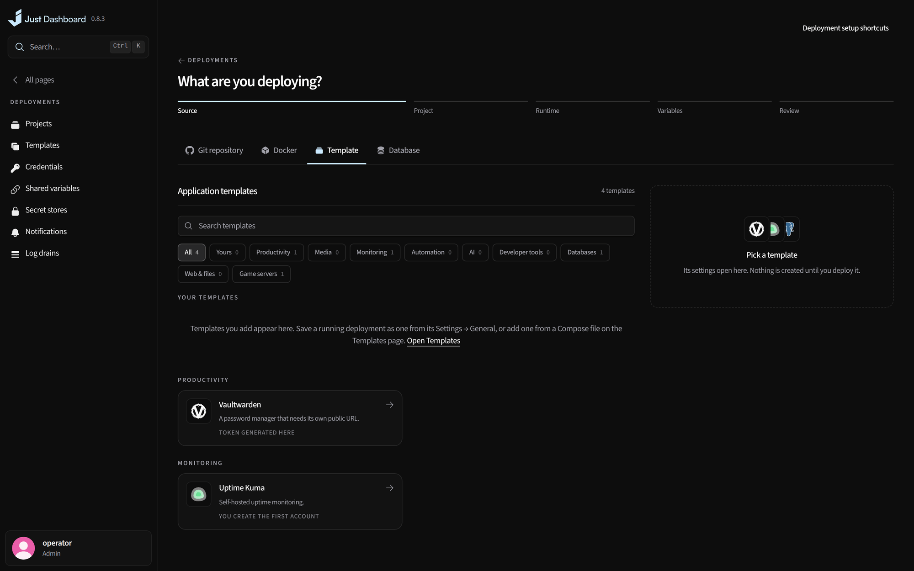
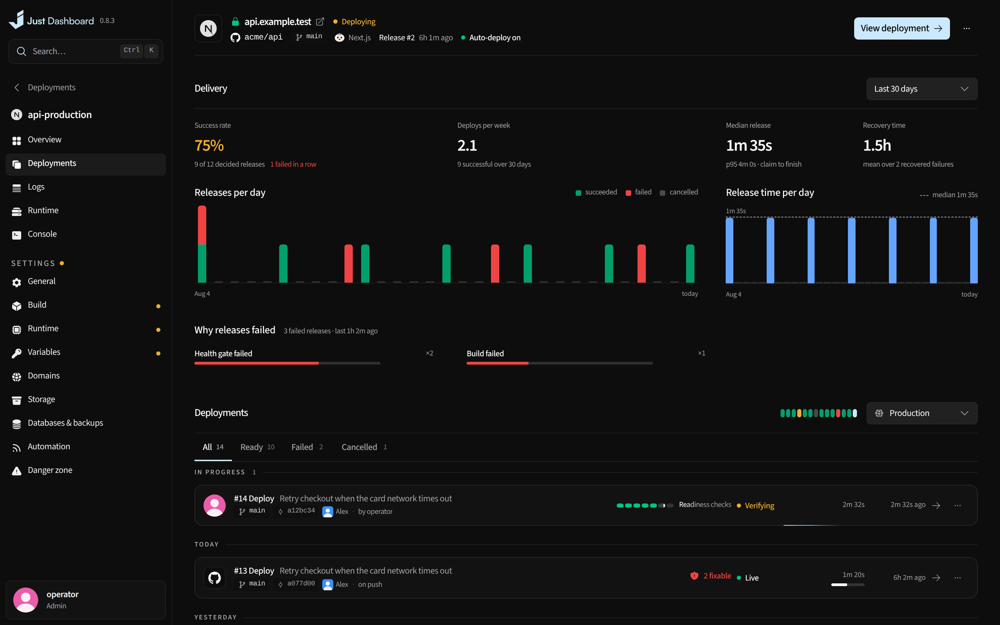
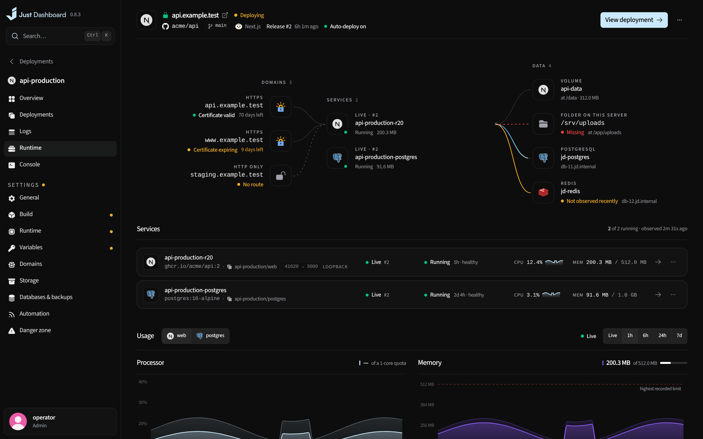
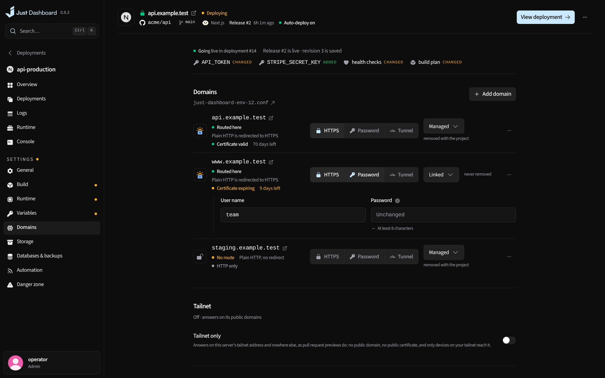
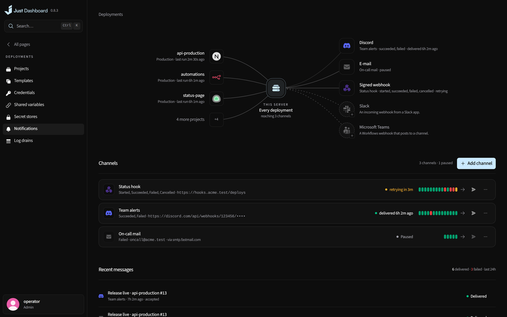

# Deployments

Ship from a repository, an image, a Compose file or a template, with releases you can roll back in one click.

<b>Projects</b> — every project, its traffic and its runs

## Deploy almost anything

- Deploy from a repository, an image, a Compose stack or **157 reviewed templates**, 56 of them multi-service stacks — an application with its own database, cache or worker
- Templates of your own beside them: a pasted Compose file or a running deployment saved as one, validated as a built-in is, its passwords made secrets each deployment generates or is asked for, exported and imported as JSON
- Minecraft Java and Bedrock servers with their console, players and settings file, kept on loopback until you open the port and its firewall rule
- Detects Node, Bun, Deno, Python, PHP, Go, Rust, Java, .NET, Ruby, Elixir and more, and builds what no recipe does with Railpack, the builder Railway and Coolify use, pinned to a reviewed release
- Push to deploy, plus pull-request previews only your tailnet can reach — Compose stacks too, every service isolated on the preview's own network and storage
- Database branches for previews: a preview's own copy of a linked PostgreSQL, MySQL or MariaDB, restored from its newest backup with chosen columns masked, removed with the preview, never for a fork

<table>
<tr>
<td width="50%" valign="top">

<b>A project</b> Live preview, release, runtime and domains

</td>
<td width="50%" valign="top">

<b>New project</b> A repository, an image, a stack or a template

</td>
</tr>
</table>

## Releases you can trust

- Immutable releases, one-click rollback and health-gated cutover
- Up to eight replicas of a stateless release behind one route, cut over and rolled back together
- Canary releases: a new release takes a share of the requests beside the live one, read side by side, and is removed if it does worse or promoted when it does not
- Skew protection: a visitor stays on the release that first answered them for the warm window after a cutover, so a page loaded before it never asks the new release for scripts it does not have
- A staging environment on its own branch, promoted to production as the exact image it ran, with no rebuild
- Migrations rehearsed on a throwaway copy of the database, restored from its backup, before production
- Real recent requests replayed against a new release before traffic moves, so a page it broke stops it
- Each release remembers where its database stood when it went live: bring that data back into a side copy to compare or restore from

<table>
<tr>
<td width="50%" valign="top">

<b>Delivery</b> Success rate, release time and why releases failed

</td>
<td width="50%" valign="top">

<b>Runtime</b> Domains, services and data, with live usage

</td>
</tr>
</table>

## Runtime

- Right-sizing from what each app actually used: the memory and CPU limits it should have, applied in one click
- The container flags `docker run` has, per deployment: the user it runs as, a read-only root with writable paths in memory, ulimits, the container's own sysctls and NVIDIA GPUs
- Sleep when idle: an app nobody visits is stopped, and the next visitor's request starts it and gets the page after a pause
- A maintenance page switched on at once, without a deploy, and the app's own error pages

## Domains and the edge

- HTTPS issued during the deploy, wildcard domains too, through the DNS credentials under Certificates
- A domain's DNS record created from its settings with those same credentials: the A and AAAA to this server, or a tunnel's CNAME, written into its zone at Cloudflare, Route 53, DigitalOcean, Google Cloud DNS, Linode, OVH, Gandi or your own RFC 2136 server, shown as a dry run first and never deleting a record
- Domains served through Cloudflare Tunnel from a server with no public address or open port: the connector runs as a container, and its routes and DNS records are set as each release goes live
- Edge rules per deployment: block, answer or redirect by path, method, user agent or address, a rate limit per visitor, and CrowdSec's bans refused at the route
- Sign-in in front of an app or only its previews through Authelia, Authentik or oauth2-proxy
- Apps that exist only on your tailnet, opened only by the Tailscale logins and tags you list, with no public domain, no sign-in server and no certificate to order

## Variables and secrets

- Variables per environment, plus shared ones defined once for the server or a project
- Variables read from HashiCorp Vault, OpenBao, Infisical, Doppler, AWS Secrets Manager or Azure Key Vault, fresh for each run

<table>
<tr>
<td width="50%" valign="top">

<b>Domains</b> HTTPS, DNS, passwords and tunnels per domain

</td>
<td width="50%" valign="top">

<b>Notifications</b> Every channel, with its last fourteen deliveries

</td>
</tr>
</table>

## Knowing what happened

- Build logs, runtime, console, request logs and traffic alerts per project
- A failed run named from its own output, and on request explained by your own model, secrets masked
- Diagnose: ask your own model what is wrong with a deployment; it reads runs, logs, usage, events, alerts, firewall rules and pending updates only as you allow each read, and proposes a restart, rollback or maintenance that runs only when you press it
- Each release's image and the base images it was built on scanned for known vulnerabilities after the build and daily, offline; told when a fixable one meets a newer base, rebuilt in one click
- Request insights that count real visitors apart from bots, with their devices and pages
- Notifications to Discord, Slack, Microsoft Teams, Mattermost, Telegram, ntfy, Gotify, Pushover, e-mail and webhooks
- Commit statuses and preview comments on GitHub, GitLab, Gitea and Forgejo
- Log drains: container output and requests to OpenTelemetry, Grafana Loki or any JSON-lines endpoint, and every request as an OpenTelemetry span under the `traceparent` the ingress sends your app

## Automate it

- The [`jd` command line](../guides/cli.md) and deploy keys for CI: create, configure, deploy, follow, roll back, promote, keep or switch back, maintenance, status, set variables

---

<a href="monitoring.md">← Overview & monitoring</a> &nbsp;·&nbsp; <a href="../../FEATURES.md"><b>All features</b></a> &nbsp;·&nbsp; <a href="docker.md">Docker →</a>

