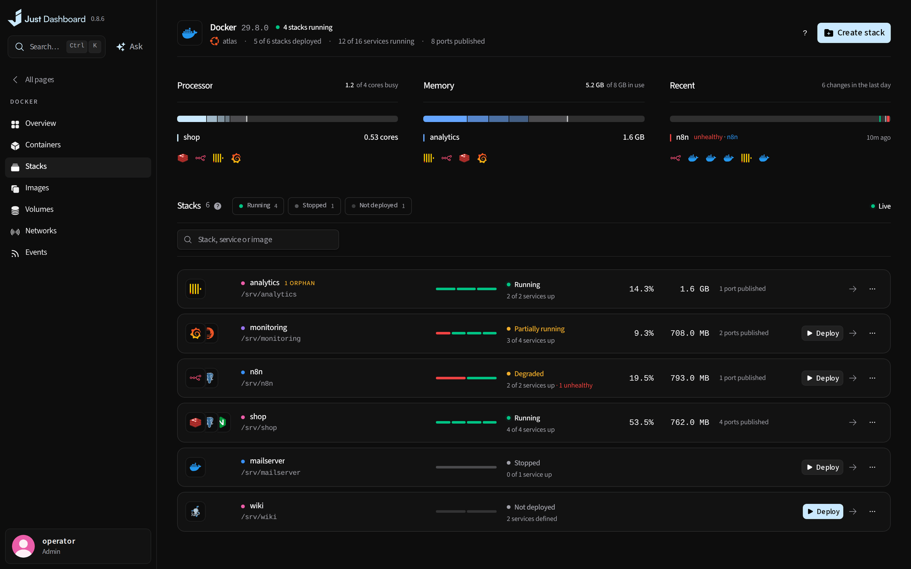
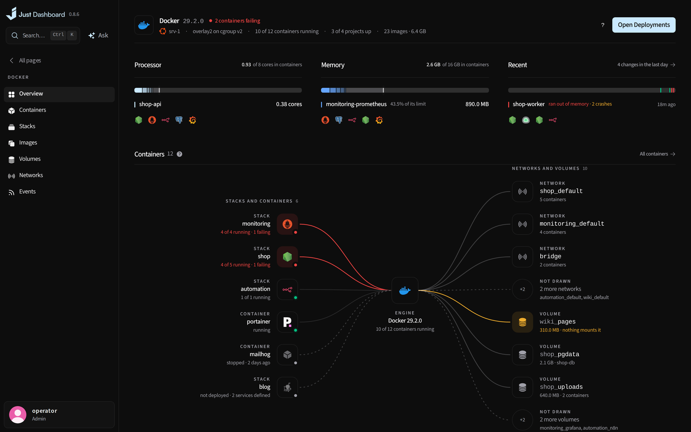

# Docker

Every container, stack, image, volume and network on the server, with what each one uses and what just happened to it.

<b>Stacks</b> — who uses what, and what just happened

## What you get

- Overview of what the containers use, what just happened to them, and the engine drawn with its stacks, networks and volumes, the failing ones lit
- Containers, stacks, images, volumes, networks and events, each a page
- Create from a template, a pasted `docker run` or a form
- Docker state, health checks and recorded lifecycle events
- Reviewed container configuration and live resource limits
- Browse a volume's or a container's files in place
- Where Docker does not answer, the page says which fault it is and fixes it in place: Start Docker for a stopped daemon, Install Docker where there is none

<b>Docker overview</b> — what the engine holds, what is failing and what it is using

---

<a href="deployments.md">← Deployments</a> &nbsp;·&nbsp; <a href="../../FEATURES.md"><b>All features</b></a> &nbsp;·&nbsp; <a href="databases.md">Databases →</a>

