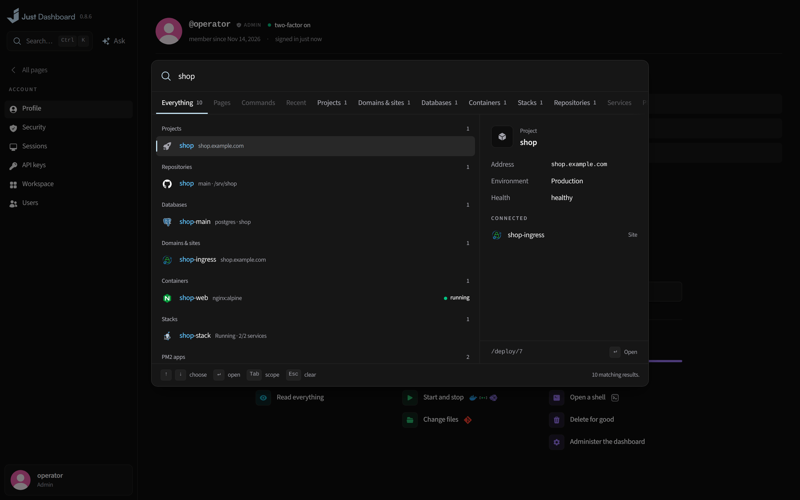

# Everywhere

The things that work the same on every page.

<b>Ctrl/⌘K</b> — everything one keystroke away

## What you get

- **Ctrl/⌘K** searches projects, sites, containers, databases, repos and pages
- Previews each result with what it is connected to
- Keyboard shortcuts on every page — press **?** to see them
- An assistant on your own model for the whole server: ask it anything, as you would any assistant, with a screenshot pasted in if that says it better, and it reads and changes what you could — databases, backups, Docker, files, the firewall, deployments and their code — as you, asking before changes unless you give it full access, with secret values masked before your model sees them. Its chats are saved, so you can come back to one later or from another browser
- Every page remembers where you left it
- A consistent, dark design built around readings rather than tiles

---

<a href="server-accounts.md">← Server & accounts</a> &nbsp;·&nbsp; <a href="../../FEATURES.md"><b>All features</b></a> &nbsp;·&nbsp; <a href="monitoring.md">Overview & monitoring →</a>

