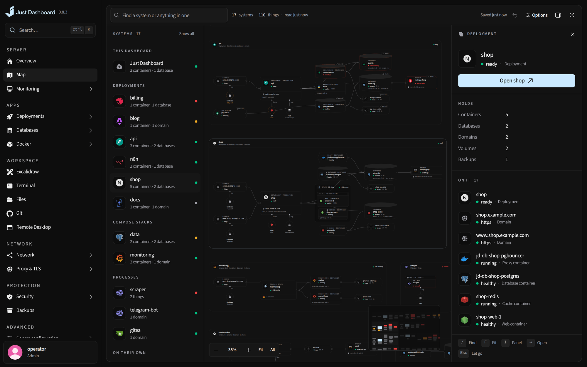
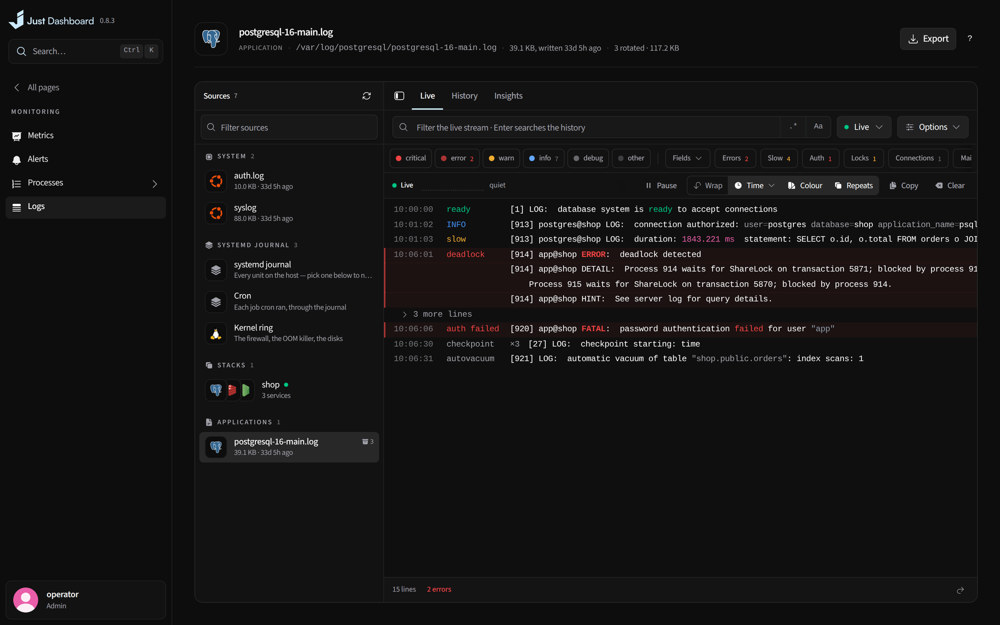
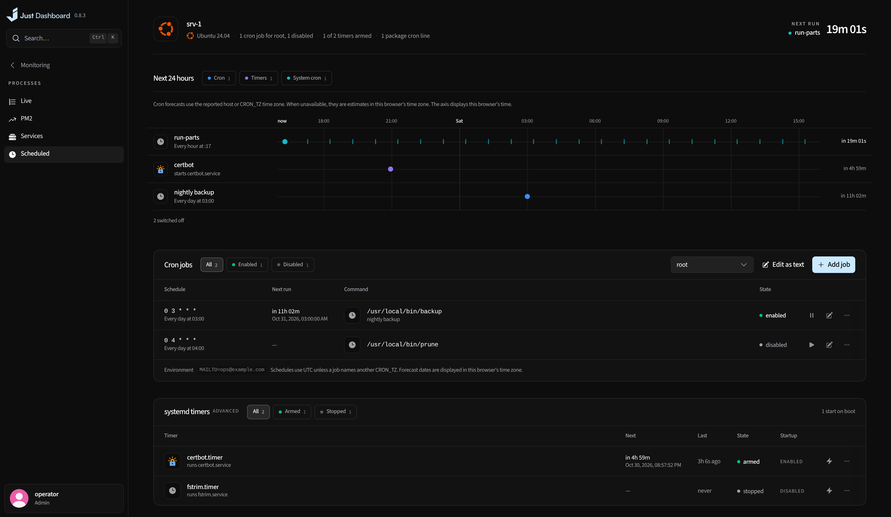

# Overview & monitoring

See what the server is doing right now, what it did this week, and what is about to run out.

<b>Overview</b> — the machine, its readings, and a shortcut to every section

## The whole machine at a glance

- A live overview of the machine: CPU, memory, load, network, storage and disk I/O
- Shortcuts to every section, with the open shells, the drawings edited last, the databases and every backup job one press away
- Notable moments, top processes and the day's activity at a glance

## A map of the server

- The server in the middle and everything it runs branching off it — projects, containers, databases, domains, backups, shells, accounts — wired together where the server knows they are
- Arranged however you like, and remembered

<b>Map</b> — everything the server runs, and what it is wired to

## History, alerts and forecasts

- Metrics with seven days of history the backend records itself, and CSV export
- Alerts when the CPU or memory stays high, a disk fills, a container goes down, a backup fails or a deployment's image has a fixable vulnerability a newer base would bring
- A capacity forecast: when each disk fills at the rate it has been growing, and whose volumes grow fastest

## Processes and logs

- Processes, PM2 apps, systemd services and scheduled jobs, each with its verbs
- One log viewer for files, containers, stacks, PM2 and the journal, with insights
- Every service shows its own logs on its own page

<table>
<tr>
<td width="50%" valign="top">

<b>Metrics</b> A week of history, recorded by the server

</td>
<td width="50%" valign="top">

<b>Logs</b> Every source in one viewer, with insights

</td>
</tr>
</table>

<b>Scheduled jobs</b> — the next 24 hours of cron and timers, with their verbs

---

<a href="everywhere.md">← Everywhere</a> &nbsp;·&nbsp; <a href="../../FEATURES.md"><b>All features</b></a> &nbsp;·&nbsp; <a href="deployments.md">Deployments →</a>

