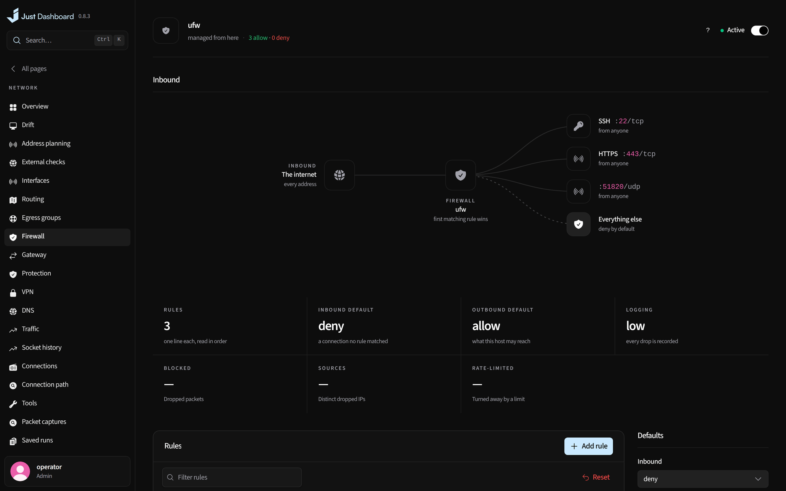
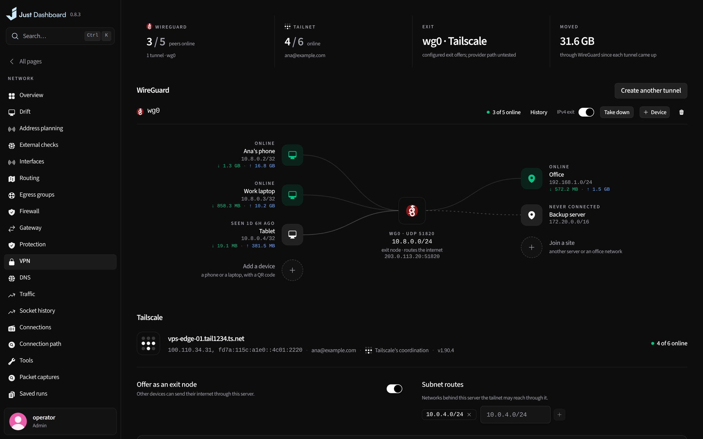
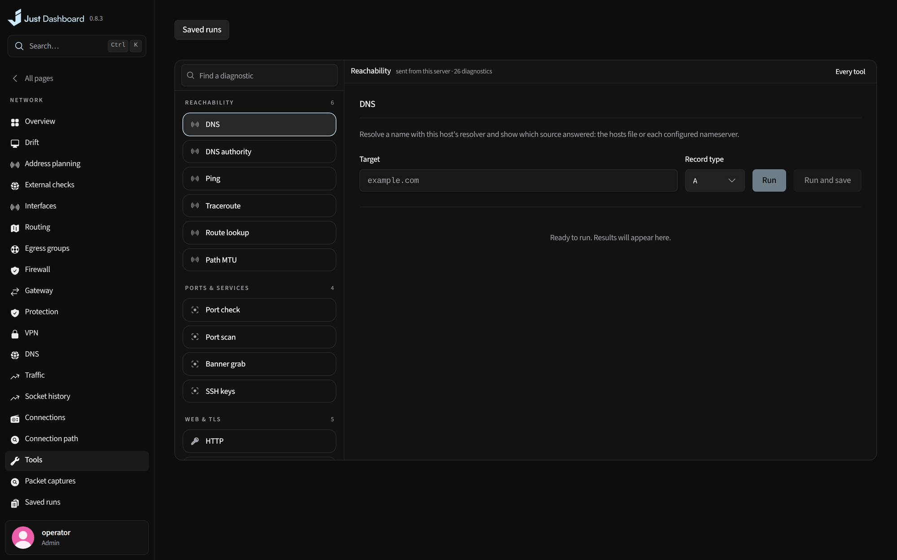

# Network

The server as a router: its links, tunnels and firewall drawn live, with the tools to find out what is wrong.

<b>Topology</b> — the server as a router, drawn live

## What you get

- A live topology of devices, tunnels and Docker networks
- Interfaces, bridges, VLANs, namespaces, routing and policy rules
- Firewall, port forwarding, NAT, rate limits and blocklists
- WireGuard and Tailscale, DNS and ad-blocking, egress groups with failover
- Traffic per device, program and container, plus speed limits and SQM
- 26 diagnostics, packet captures, connection paths, drift and saved runs

<table>
<tr>
<td width="50%" valign="top">

<b>Firewall</b> What gets in, and what stops it

</td>
<td width="50%" valign="top">

<b>VPN</b> WireGuard and Tailscale, peer by peer

</td>
</tr>
</table>

<b>Diagnostics</b> — find a fault from the server's side of it

---

<a href="workspace.md">← Workspace</a> &nbsp;·&nbsp; <a href="../../FEATURES.md"><b>All features</b></a> &nbsp;·&nbsp; <a href="proxy-tls.md">Proxy & TLS →</a>

