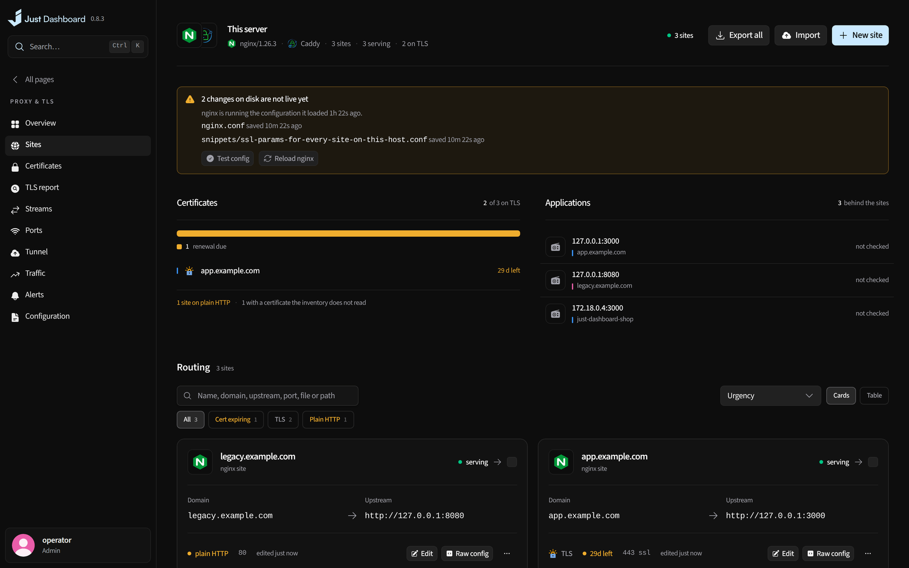
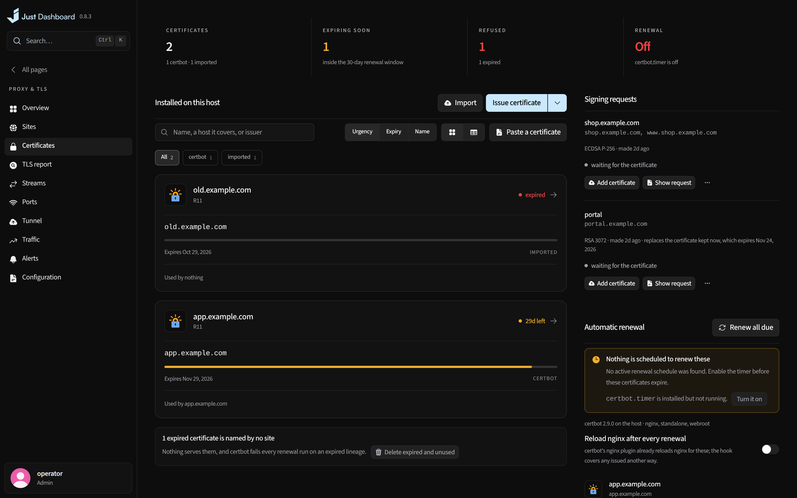
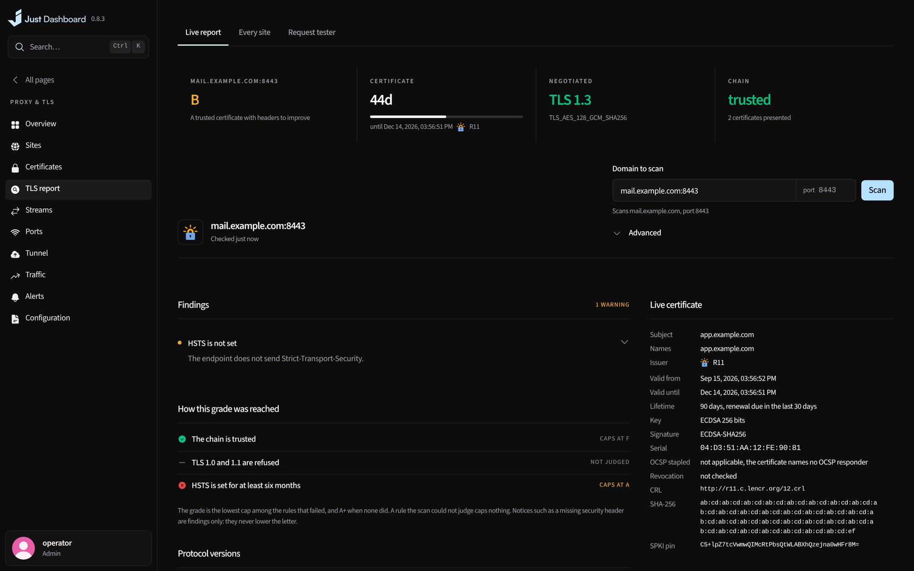

# Proxy & TLS

Every domain drawn through nginx or Caddy to the application it reaches, with its certificate beside it.

<b>Proxy overview</b> — domains, applications and certificates

## What you get

- Every domain drawn through nginx or Caddy to the application it reaches
- Sites written as ordinary config, with a builder for auth and access rules
- Certificates through certbot, including DNS wildcards, with runway at a glance
- A live TLS report, streams, ports and per-site traffic
- Alerts on renewals and certificate drift

<table>
<tr>
<td width="50%" valign="top">

<b>Sites</b> Ordinary config, with a builder beside it

</td>
<td width="50%" valign="top">

<b>Certificates</b> Every certificate, with its runway

</td>
</tr>
</table>

<b>TLS report</b> — the grade, and exactly how it was reached

---

<a href="network.md">← Network</a> &nbsp;·&nbsp; <a href="../../FEATURES.md"><b>All features</b></a> &nbsp;·&nbsp; <a href="security-backups.md">Security & backups →</a>

