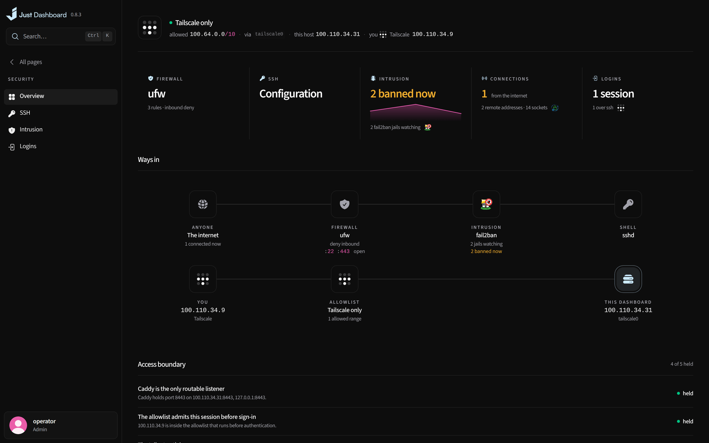
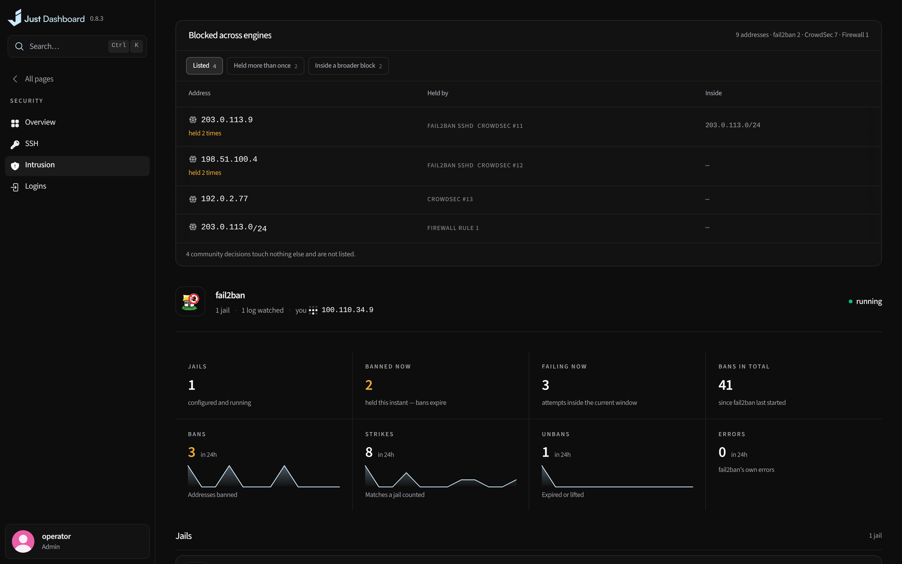
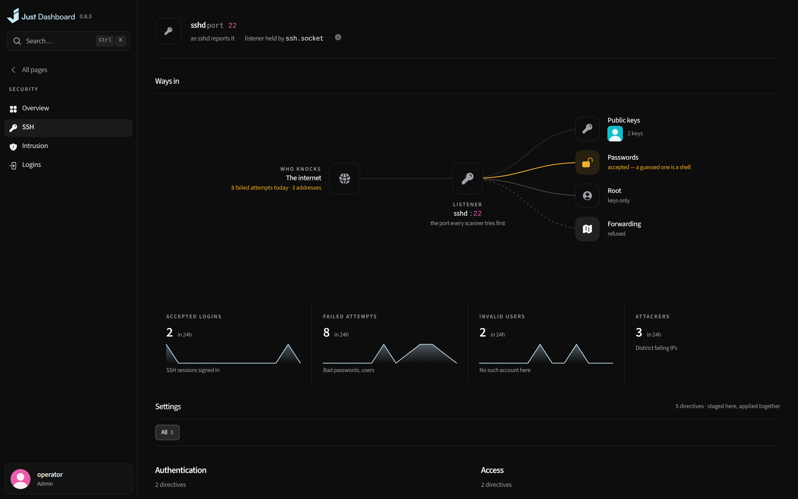

# Security & backups

A verdict on how exposed the host is, and a map of everything that is not backed up yet.

<b>Security</b> — exposure, SSH, logins and who is attacking

## Security

- A verdict on the host: exposure, SSH, logins and who is attacking
- fail2ban, CrowdSec and Suricata where they run

<table>
<tr>
<td width="50%" valign="top">

<b>Intrusion</b> What is blocked, by which engine, and why

</td>
<td width="50%" valign="top">

<b>SSH</b> Who knocks, how they get in, and what is allowed

</td>
</tr>
</table>

## Backups

- Scheduled backups to disk, S3, Backblaze B2, an SFTP server or Google Drive, OneDrive, Dropbox, WebDAV and the other services rclone speaks, encrypted on the way out, and native database dumps
- A coverage map of everything that is *not* backed up yet
- Single-file and in-place restore, on this server or a fresh one: import what a destination holds and restore it there, its Docker volumes made again

<b>Backups</b> — what is covered, and what is not

The dashboard's own security model is in [SECURITY.md](../../SECURITY.md).

---

<a href="proxy-tls.md">← Proxy & TLS</a> &nbsp;·&nbsp; <a href="../../FEATURES.md"><b>All features</b></a> &nbsp;·&nbsp; <a href="server-accounts.md">Server & accounts →</a>

