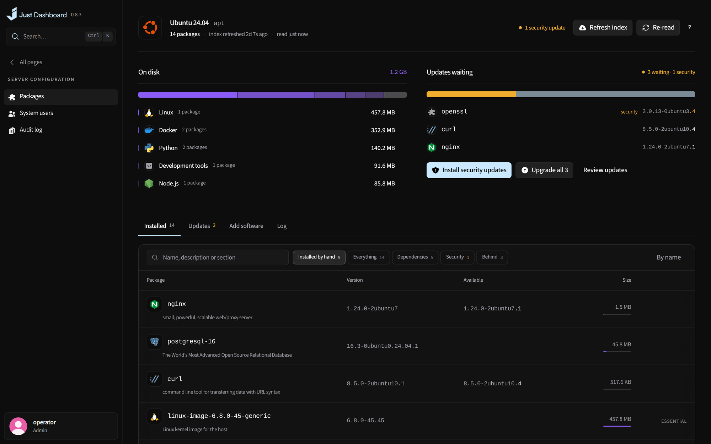
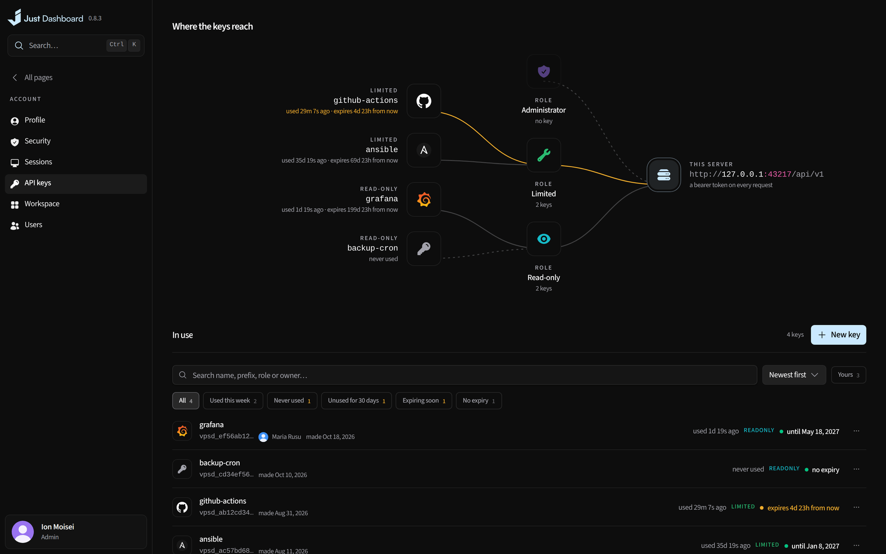

# Server & accounts

The host itself and the people on it: packages, system users, roles, keys and the panel's own settings.

<b>System users</b> — who can get in, and how far they reach

## The server

- Host package updates on apt, dnf, yum, zypper, pacman or apk
- System users, an audit log of every change and the panel's own settings
- Address, certificate, allowlist and ports applied with automatic rollback
- One-click self-update, with the release notes compiled in

## Accounts

- Roles, two-factor, passkeys, sessions and API keys for every account
- Search and replace API keys, with explicit revocation and inactive-record cleanup
- A first-run question that keeps the sections you don't use out of your sidebar
- Optionally linked to your just-dashboard.com account, at a scope you choose, to see this server from the site ([what it sends](../guides/linking-and-usage.md))

<table>
<tr>
<td width="50%" valign="top">

<b>Packages</b> What is on disk, and which updates are waiting

</td>
<td width="50%" valign="top">

<b>API keys</b> Who holds a key, and how far it reaches

</td>
</tr>
</table>

---

<a href="security-backups.md">← Security & backups</a> &nbsp;·&nbsp; <a href="../../FEATURES.md"><b>All features</b></a> &nbsp;·&nbsp; <a href="everywhere.md">Everywhere →</a>

