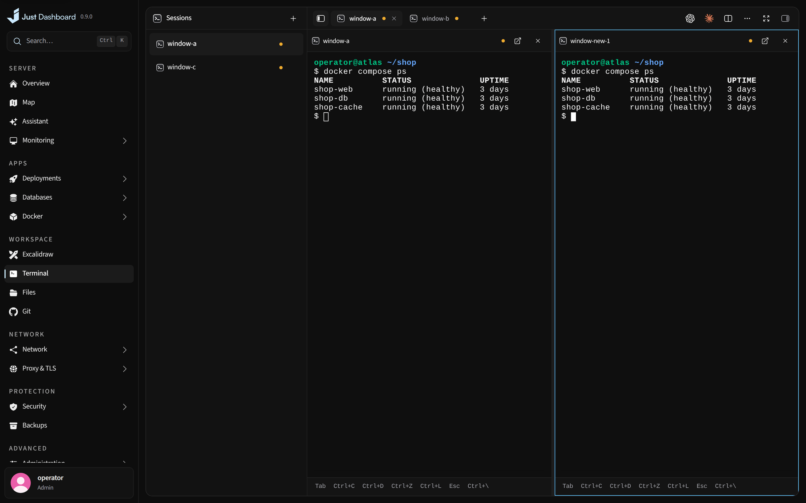
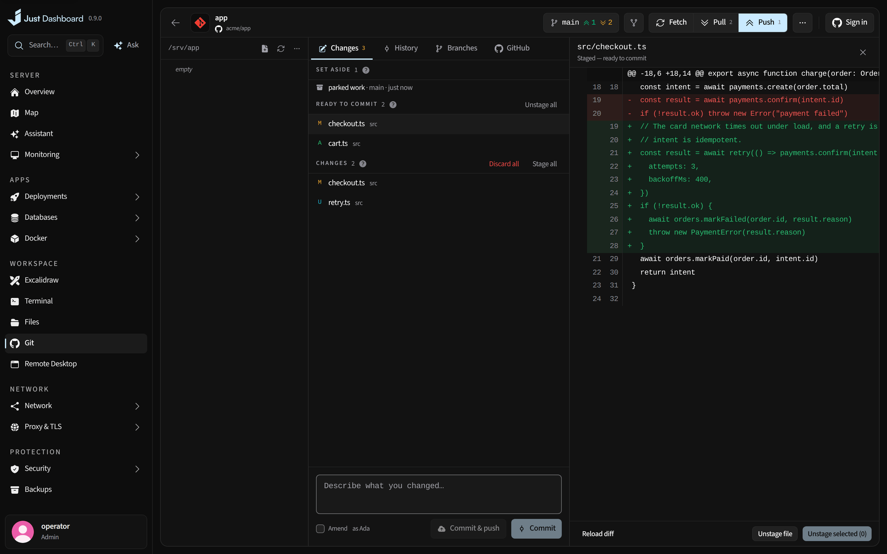
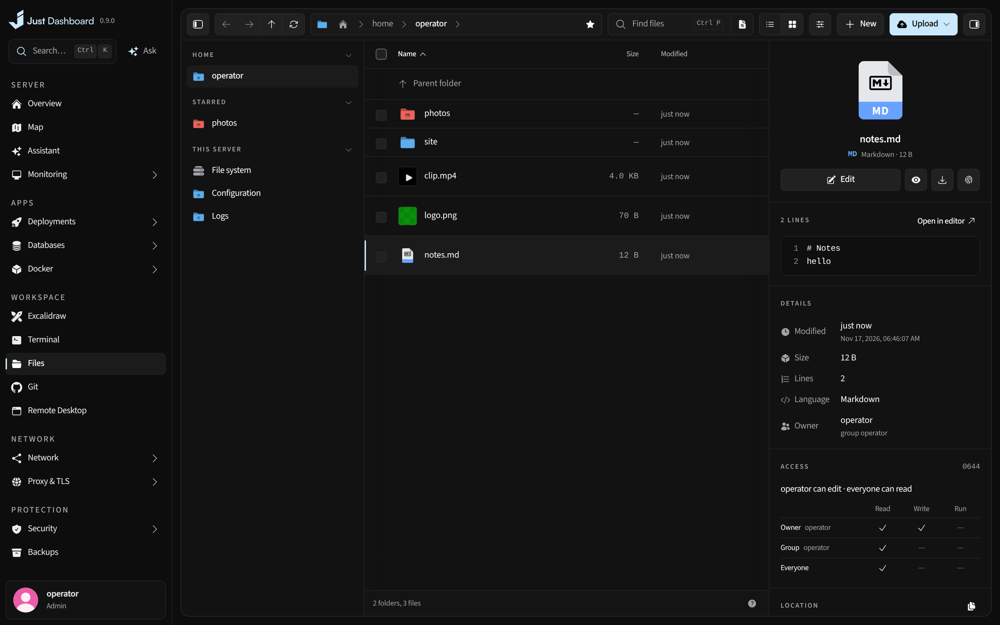
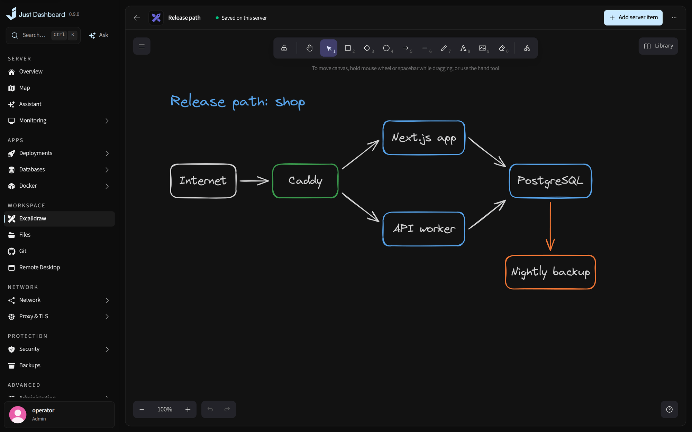
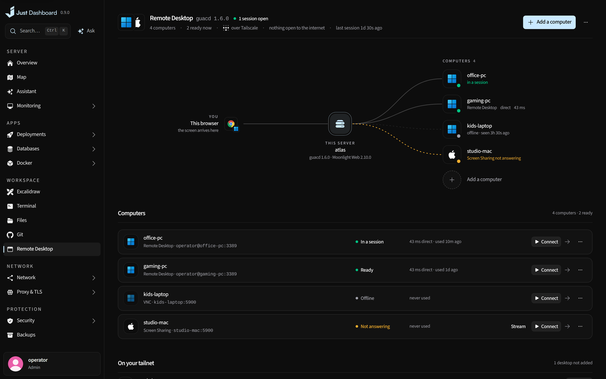

# Workspace

A real terminal, files, Git on the server and on GitHub, drawings and your own computers, all in the same browser tab.

<b>Terminal</b> — persistent sessions and split panes

## Terminal

- A real terminal whose sessions survive the tab closing and dashboard restarts
- Split panes, drag-and-drop docking and one-click Codex and Claude launchers

## Files and Git

- A file manager with search, previews, Monaco and image editors
- Every file keeps its earlier versions: each save through the dashboard, and each backup that holds it, with a diff and a restore; an edit made in a shell between two saves is caught and labelled at the next one
- Folders and files that know the server: a container's volume, a site's root, a Git checkout with its uncommitted changes, a deployment's source, a database's data, and whether a backup covers it, each linked to its page
- Markdown shown rendered, CSV as a table; quick thumbnails for every photo, a gallery with a slideshow, and audio that plays as a queue while you browse
- Folders that follow the disk as other programs change them, uploads of any size that pause and carry on after a dropped connection, and links fetched straight onto the server
- Files and the file editor one pane at a time on a phone, with a bottom bar for places, the folder and its details
- A Trash for everything deleted in Files, kept 30 days, with Restore, and Undo (or Ctrl+Z) after a delete, move, rename or copy
- Find that answers from an index of every name on the server, however big the tree
- A full Git workspace: staging by line, history, branches, conflicts, PR reviews
- GitHub, GitLab and Gitea pull requests and Actions logs, with the screenshots and videos a pull request embeds drawn in place
- One pane at a time on a phone, with a bottom bar for changes, history, branches, GitHub and files

## GitHub

**Local Git** is the checkouts on this server; **GitHub** is the repositories on GitHub, through an
App the dashboard sets up for itself and each person's own GitHub sign-in ([how to connect it](../guides/github.md)).

- A home like your GitHub profile: your face, bio and the year of contributions as GitHub's green calendar with your streaks, the repositories you pushed to last, your open pull requests, the reviews asked of you, the issues assigned to you and your public activity
- Every pull request and issue you opened, are assigned, are asked to review or are mentioned in, across every repository, open or closed; one in a repository listed here opens on its page, ready to merge or close
- Every repository your accounts and organisations reach as a card with its language's logo, stars, forks and open issues, what the App was given on each installation, counts of public and private, search, filters by owner, language, visibility and archived, and sorting
- New repositories with a README, a .gitignore template and a licence, under your account or an organisation
- A page per repository: its README under the last commit, its languages in GitHub's colours, branches with their protection and rules, commits, pull requests with reviews and checks (merge, close, reopen), issues with labels, Actions (run a workflow with its inputs, re-run, cancel), collaborators and invitations, and its settings, archiving, visibility and deletion
- Every control checks your role on the repository and what the App was granted, and says which is missing when it is off
- Clone to server copies a repository into a Git root with a read-only token for that repository alone, and opens it in Local Git when it lands

<table>
<tr>
<td width="50%" valign="top">

<b>Git</b> Stage, review and ship from the browser

</td>
<td width="50%" valign="top">

<b>Files</b> Browse, preview and edit anywhere you allow

</td>
</tr>
</table>

## Drawings and computers

- Excalidraw: drawings you edit together live, with live cards for the host, projects and databases, a shared shape library from libraries.excalidraw.com, diagrams written from a description, and each drawing listed as a thumbnail of itself
- Remote Desktop: your Windows PCs, Macs and Linux desktops in a browser tab over Tailscale, unattended, with clipboard and file transfer, and a Stream mode that plays the screen as 60 fps video from Sunshine

<table>
<tr>
<td width="50%" valign="top">

<b>Excalidraw</b> Drawings kept on the server and edited together live

</td>
<td width="50%" valign="top">

<b>Remote Desktop</b> Your own PCs and Macs in a tab, over Tailscale

</td>
</tr>
</table>

---

<a href="databases.md">← Databases</a> &nbsp;·&nbsp; <a href="../../FEATURES.md"><b>All features</b></a> &nbsp;·&nbsp; <a href="network.md">Network →</a>

